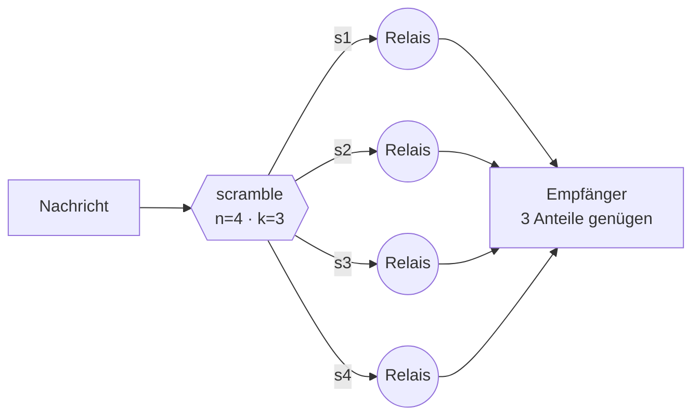

# ScrambNet

*Ein Anonymitätsnetz, das keine Glaubensakte verlangt: weder an die Geheimhaltung seiner Algorithmen, noch an deren rechnerische Stärke, noch an irgendeine zentrale Instanz.*

[English](README.md) · [Italiano](README.it.md) · [Español](README.es.md) · **[Deutsch](README.de.md)** · [Français](README.fr.md) · [中文](README.zh-CN.md)

**Status: Vor-Spezifikation.** Noch kein Code, mit Absicht: zuerst das Bedrohungsmodell, dann die Protokollspezifikation, dann der Code. Dieses Repository ist der Treffpunkt für alle, die mitbauen wollen.

## Drei Verweigerungen

Fast alle Anonymitätsnetze stehen auf drei Beinen aus Vertrauen. ScrambNet ist so entworfen, dass alle drei wegfallen:

1. **Keine Geheimhaltung des Entwurfs.** Das Kerckhoffs-Prinzip wörtlich genommen: öffentliche Spezifikation im RFC-Stil, Open Source, reproduzierbare Builds. Der Gegner darf jede Zeile lesen; die Sicherheit liegt in den Schlüsseln der Nutzer und in der Form des Netzes.
2. **Keine Abhängigkeit von rechnerischer Härte.** „Das zu brechen würde Milliarden Jahre kosten" ist ein Versprechen über die Trägheit des Universums, und solche Versprechen laufen erfahrungsgemäß ab (DES, RC4, SHA-1 — und Quantencomputer am Horizont). Die tragende Wand darf nicht ablaufen.
3. **Kein einzelner Punkt, den man beschlagnahmen kann.** Keine Directory Authorities, kein unverzichtbarer Server, kein Update-Schlüssel in einer einzigen Hand. Der Kill-Switch ist nicht verboten: er existiert nicht.

## Die Kernidee: Stärke durch Streuung

Jede Nachricht wird mit Shamirs Secret Sharing in `n` Anteile zerlegt, von denen beliebige `k` sie rekonstruieren und `k−1` **mathematisch nicht von Rauschen zu unterscheiden** sind — nicht schwer zu entschlüsseln: leer. Die Anteile reisen über disjunkte Pfade: verschiedene Wächter, verschiedene Jurisdiktionen, bei Bedarf verschiedene Transporte (ein Anteil in einem gewöhnlichen TLS-Strom, einer in etwas, das wie ein Videoanruf aussieht, einer über das lokale Mesh).

Den Verkehr zu lesen hört auf, ein Kryptoanalyse-Problem zu sein, und wird ein Problem physischer Besetzung: Der Gegner muss `k` Punkte des Netzes im selben Augenblick besitzen. Die Zwiebelverschlüsselung bleibt, herabgestuft zum zweiten Gürtel: Fällt sie eines Tages, wird das Netz nicht lesbar — nur unbequemer.

Der Preis wird offen ausgewiesen: `n` Anteile kosten die `n`-fache Bandbreite. Das ist der Tausch, den dieses Paradigma vorschlägt: Effizienz gegen Sicherheit ohne Annahmen.

## Die Architektur im Überblick

| Schicht | Name | Aufgabe |
|---|---|---|
| L0 | Identität | Schlüsselpaare, auf dem Gerät erzeugt. Keine Registrierung, keine Telefonnummer, keine E-Mail. Eine Identität, die niemand ausstellt, kann niemand widerrufen. |
| L1 | Entdeckung | Keine Directory Authorities. Gossip selbstsignierter Relais-Listen; jeder Client hält eine überprüfbare Stichprobe (vgl. Walking Onions). Neue Nutzer kommen über den sozialen Graphen herein (vgl. Tors Lox). |
| L2 | Routing | Ein Zwiebel-Circuit pro Anteil: 3 Hops, Sphinx-Pakete fester Größe, langlebige Wächter. Zwei Gänge: schnell (Browsing-Latenz) und paranoid (Mixnet mit Verzögerungen und Decktraffic). |
| L3 | Transport | Chamäleon-Hüllen: Der Verkehr imitiert gewöhnliches TLS (uTLS, ECH) oder WebRTC-Anrufe. Ihn zu blockieren muss den Zensor mehr kosten, als es ihm einbringt. |
| L4 | Blackout | Wenn das Internet abgeschaltet wird: lokales Mesh (Wi-Fi Direct, Bluetooth), Store-and-Forward. Das Netz degradiert; es stirbt nicht. |

Alle Details: [docs/architecture.md](docs/architecture.md) · Ehrliche Grenzen: [docs/threat-model.md](docs/threat-model.md) *(auf Englisch; Übersetzungen sind willkommen)*

## Was es nicht verspricht

Ein globaler passiver Beobachter, der allen Verkehr zugleich sieht, schlägt den schnellen Modus — dieselbe Grenze, die Tor seit seinem ersten Design-Paper offenlegt. Nur der paranoide Modus (Mixnet) stellt sich ihm. Ein Netz, das totalen Schutz verspricht, lügt, und wer echte Risiken trägt, verdient zu wissen, wo genau der Schirm endet.

## Fast nichts zu erfinden

Shamir (1979), Rabins Information Dispersal (1989), Chaums DC-Netze (1988), Sphinx (2009), Tors Snowflake und Lox, das Noise Protocol Framework, Briar und Reticulum für die Blackout-Schicht, Walking Onions für die Entdeckung per Stichprobe. Die eigentliche Arbeit ist Komposition und Disziplin: Muss irgendein Detail des Entwurfs geheim bleiben, damit das System funktioniert, dann ist dieses Detail ein Fehler.

## Fahrplan

1. **Bedrohungsmodell** — wird jetzt in den Issues diskutiert. Greift es an.
2. **Protokollspezifikation** — das Anteil-Paket, der Gossip-Eintrag, der Handshake. RFC-Stil, öffentlich.
3. **Referenz-Client** — ein einziger kleiner, langweiliger Client. Mobile zuerst: Anonymität, die nur auf einem neuen Laptop läuft, ist nichts für die, die sie am dringendsten brauchen.

## Mitmachen

Pseudonyme Beiträge sind willkommen und erwartet — siehe [CONTRIBUTING.md](CONTRIBUTING.md). Die Diskussion findet vorerst in den Issues dieses Repositories statt. Übersetzungen der Dokumentation sind ein geschätzter erster Beitrag.

Eine Regel über allen: **Dieses Netz transportiert Pakete, keine Meinungen.** Es schützt Dissidenten und ihre Gegner mit derselben Mathematik. Politische Gegner sind keine Feinde, und eine Infrastruktur ist nur glaubwürdig, wenn sie keine Seite wählen kann.

## Lizenz

Spezifikation und Dokumentation: [CC0 1.0](LICENSE) (gemeinfrei). Der künftige Code wählt seine Lizenz im Konsens der Beitragenden.
