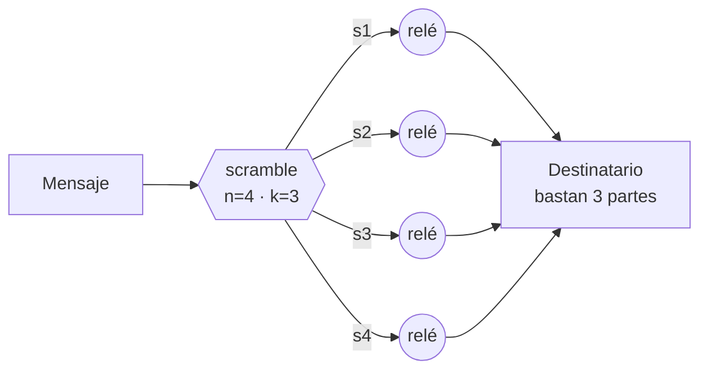

# ScrambNet

*Una red de anonimato que no pide actos de fe: ni en el secreto de sus algoritmos, ni en su fortaleza computacional, ni en ninguna parte central.*

[English](README.md) · [Italiano](README.it.md) · **[Español](README.es.md)** · [Deutsch](README.de.md) · [Français](README.fr.md) · [中文](README.zh-CN.md)

**Estado: pre-alpha.** Un modelo de amenazas, una especificación del protocolo en crecimiento y una prueba de concepto ejecutable — todavía no un sistema con el que proteger secretos reales. Este repositorio es el punto de encuentro para quienes quieran construirla, y atacarla. Mira [cómo se compara](COMPARISON.md) y [cómo informar de una brecha](SECURITY.md).

## Tres rechazos

Casi todas las redes de anonimato se apoyan en tres patas de confianza. ScrambNet está diseñada para eliminar las tres:

1. **Ningún secreto de diseño.** El principio de Kerckhoffs al pie de la letra: especificación pública al estilo RFC, código abierto, compilaciones reproducibles. El adversario puede leer cada línea; la seguridad vive en las claves de los usuarios y en la forma de la red.
2. **Ninguna dependencia de la dificultad computacional.** «Romper esto costaría miles de millones de años» es una promesa sobre la pereza del universo, y esas promesas tienen historial de caducar (DES, RC4, SHA-1 — y los ordenadores cuánticos en el horizonte). El muro de carga no debe caducar.
3. **Ningún punto único que confiscar.** Sin autoridades de directorio, sin servidor imprescindible, sin clave de actualización en manos de uno solo. El interruptor de apagado no está prohibido: es inexistente.

## La idea central: la fuerza de la dispersión

Cada mensaje se divide con el esquema de Shamir en `n` partes tales que `k` cualesquiera lo reconstruyen y `k−1` son **matemáticamente indistinguibles del ruido** — no difíciles de descifrar: vacías. Las partes viajan por rutas disjuntas: guardias distintos, jurisdicciones distintas y, cuando hace falta, transportes distintos (una parte dentro de un flujo TLS corriente, otra dentro de lo que parece una videollamada, otra por la malla local).



Leer el tráfico deja de ser un problema de criptoanálisis y se convierte en un problema de ocupación física: el adversario necesita poseer `k` puntos de la red en el mismo instante. El cifrado de cebolla permanece, degradado a segundo cinturón: si algún día cae, la red no se vuelve legible — solo se vuelve menos cómoda.

El precio se declara de entrada: `n` partes cuestan `n` veces el ancho de banda. Ese es el intercambio que propone este paradigma: eficiencia a cambio de una seguridad sin hipótesis.

## La arquitectura de un vistazo

| Capa | Nombre | Qué hace |
|---|---|---|
| L0 | Identidad | Claves generadas en el dispositivo. Sin registro, sin teléfono, sin correo. Una identidad que nadie emite es una identidad que nadie puede revocar. |
| L1 | Descubrimiento | Sin autoridades de directorio. Gossip de listas firmadas por los propios relés; cada cliente conoce una muestra verificable (cf. Walking Onions). Los nuevos usuarios entran por el grafo social (cf. Lox de Tor). |
| L2 | Enrutamiento | Un circuito de cebolla por parte: 3 saltos, paquetes Sphinx de tamaño fijo, guardias estables. Dos marchas: rápida (latencia de navegación) y paranoica (mixnet con retardos y tráfico de cobertura). |
| L3 | Transporte | Envolturas camaleón: el tráfico imita TLS corriente (uTLS, ECH) o llamadas WebRTC. Bloquearlo debe costarle al censor más de lo que le rinde. |
| L4 | Apagón | Cuando apagan internet: malla local (Wi-Fi Direct, Bluetooth), store-and-forward. La red se degrada; no muere. |

Detalles completos: [docs/architecture.md](docs/architecture.md) · Límites declarados: [docs/threat-model.md](docs/threat-model.md) *(en inglés; las traducciones son bienvenidas)* · Especificación del protocolo: [docs/spec/](docs/spec/) · Posicionamiento: [COMPARISON.md](COMPARISON.md)

## Ejecuta la prueba de concepto

Las partes que sostienen el diseño son ejecutables, como una especificación que puedes atacar:

```
cd poc
python3 dispersal.py      # dispersión k-de-n y el umbral I-2, por fuerza bruta
python3 rendezvous.py     # entrega por dead-drop y sondeo disciplinado
python3 network_sim.py    # un adversario de k-rutas frente al tamaño de la red, en números
```

Pura biblioteca estándar de Python, sin dependencias, sin red. Es un juguete
por diseño (ver [poc/README.md](poc/README.md)): no protejas nada con él. Su
cometido es hacer el diseño lo bastante concreto como para romperlo.

## Lo que no promete

Un observador global pasivo que ve todo el tráfico mundial a la vez derrota al modo rápido — el mismo límite que Tor declara desde su primer artículo de diseño. Solo el modo paranoico (mixnet) lo afronta. Una red que promete protección total miente, y quien corre riesgos reales merece saber exactamente dónde termina el paraguas.

## Casi nada que inventar

Shamir (1979), la dispersión de información de Rabin (1989), las DC-nets de Chaum (1988), Sphinx (2009), Snowflake y Lox de Tor, el Noise Protocol Framework, Briar y Reticulum para la capa de apagón, Walking Onions para el descubrimiento por muestreo. El trabajo real es de composición y disciplina: si algún detalle del diseño debe permanecer secreto para funcionar, ese detalle es un defecto.

## Hoja de ruta

1. **Modelo de amenazas** — publicado, y bajo ataque en las [issues](../../issues). ✔ primera pasada
2. **Especificación del protocolo** — el paquete de parte, el registro de gossip, el rendezvous y la selección de rutas están esbozados ([docs/spec/](docs/spec/)); los transportes camaleón (Parte 4) y el encuadre para el apagón (Parte 5) son lo siguiente.
3. **Prueba de concepto** — el núcleo de dispersión, la entrega por dead-drop y un simulador de adversario funcionan hoy en [poc/](poc/). ✔ primera pasada
4. **Nodo de referencia** — un único nodo pequeño y aburrido, apto para móviles (probablemente en Rust), una vez que se asiente la selección de rutas (Parte 3). El anonimato que solo corre en un portátil nuevo no es para quien más lo necesita.
5. **Cliente de referencia** — un cliente de chat demostrativo, una vez que exista un nodo que lo lleve. No antes: un cliente que promete lo que la red todavía no puede entregar sería lo contrario de no pedir actos de fe.

## Contribuir

Las contribuciones seudónimas son bienvenidas y esperadas — ver [CONTRIBUTING.md](CONTRIBUTING.md). Por ahora la discusión ocurre en las issues de este repositorio. Traducir la documentación es una primera contribución muy valorada.

Una regla por encima de todas: **esta red transporta paquetes, no opiniones.** Protege a los disidentes y a sus adversarios con la misma matemática. Los adversarios políticos no son enemigos, y una infraestructura solo es creíble si no puede tomar partido.

## Licencia

Especificación y documentación: [CC0 1.0](LICENSE) (dominio público). El futuro código elegirá su licencia por consenso de los contribuidores.
