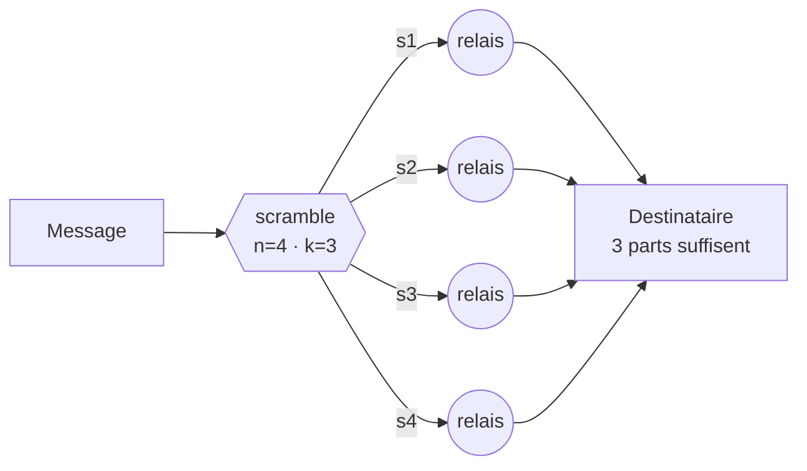

# ScrambNet

*Un réseau d'anonymat qui n'exige aucun acte de foi : ni dans le secret de ses algorithmes, ni dans leur force de calcul, ni dans aucune partie centrale.*

[English](README.md) · [Italiano](README.it.md) · [Español](README.es.md) · [Deutsch](README.de.md) · **[Français](README.fr.md)** · [中文](README.zh-CN.md)

**État : pré-spécification.** Pas encore de code, à dessein : d'abord le modèle de menace, puis la spécification du protocole, puis le code. Ce dépôt est le point de rencontre de celles et ceux qui veulent le construire.

## Trois refus

Presque tous les réseaux d'anonymat reposent sur trois piliers de confiance. ScrambNet est conçu pour les supprimer tous les trois :

1. **Aucun secret de conception.** Le principe de Kerckhoffs pris au pied de la lettre : spécification publique de style RFC, code ouvert, compilations reproductibles. L'adversaire peut lire chaque ligne ; la sécurité réside dans les clés des utilisateurs et dans la forme du réseau.
2. **Aucune dépendance à la difficulté de calcul.** « Casser ceci coûterait des milliards d'années » est une promesse sur la paresse de l'univers, et ces promesses ont l'habitude d'expirer (DES, RC4, SHA-1 — et les ordinateurs quantiques à l'horizon). Le mur porteur ne doit pas expirer.
3. **Aucun point unique à saisir.** Pas d'autorités d'annuaire, pas de serveur indispensable, pas de clé de mise à jour entre les mains d'un seul. Le bouton d'arrêt n'est pas interdit : il est inexistant.

## L'idée centrale : la force de la dispersion

Chaque message est découpé, par le partage de secret de Shamir, en `n` parts telles que `k` quelconques le reconstituent et que `k−1` soient **mathématiquement indiscernables du bruit** — pas difficiles à déchiffrer : vides. Les parts voyagent par des chemins disjoints : gardes différents, juridictions différentes et, au besoin, transports différents (une part dans un flux TLS ordinaire, une dans ce qui ressemble à un appel vidéo, une sur le maillage local).

Lire le trafic cesse d'être un problème de cryptanalyse et devient un problème d'occupation physique : l'adversaire doit tenir `k` points du réseau au même instant. Le chiffrement en oignon demeure, rétrogradé au rang de seconde ceinture : s'il tombe un jour, le réseau ne devient pas lisible — seulement moins commode.

Le prix est annoncé d'emblée : `n` parts coûtent `n` fois la bande passante. C'est l'échange que propose ce paradigme : de l'efficacité contre une sécurité sans hypothèses.

## L'architecture en un coup d'œil

| Couche | Nom | Rôle |
|---|---|---|
| L0 | Identité | Paires de clés générées sur l'appareil. Pas d'inscription, pas de téléphone, pas de courriel. Une identité que personne ne délivre est une identité que personne ne peut révoquer. |
| L1 | Découverte | Pas d'autorités d'annuaire. Gossip de listes auto-signées par les relais ; chaque client détient un échantillon vérifiable (cf. Walking Onions). Les nouveaux venus entrent par le graphe social (cf. Lox de Tor). |
| L2 | Routage | Un circuit en oignon par part : 3 sauts, paquets Sphinx de taille fixe, gardes stables. Deux vitesses : rapide (latence de navigation) et paranoïaque (mixnet avec délais et trafic de couverture). |
| L3 | Transport | Enveloppes caméléon : le trafic imite du TLS ordinaire (uTLS, ECH) ou des appels WebRTC. Le bloquer doit coûter au censeur plus que cela ne lui rapporte. |
| L4 | Blackout | Quand on coupe Internet : maillage local (Wi-Fi Direct, Bluetooth), store-and-forward. Le réseau se dégrade ; il ne meurt pas. |

Détails complets : [docs/architecture.md](docs/architecture.md) · Limites assumées : [docs/threat-model.md](docs/threat-model.md) *(en anglais ; les traductions sont bienvenues)*

## Ce qu'il ne promet pas

Un observateur global passif qui voit tout le trafic mondial à la fois bat le mode rapide — la même limite que Tor déclare depuis son premier article de conception. Seul le mode paranoïaque (mixnet) l'affronte. Un réseau qui promet une protection totale ment, et les personnes qui courent de vrais risques méritent de savoir exactement où s'arrête le parapluie.

## Presque rien à inventer

Shamir (1979), la dispersion d'information de Rabin (1989), les DC-nets de Chaum (1988), Sphinx (2009), Snowflake et Lox de Tor, le Noise Protocol Framework, Briar et Reticulum pour la couche blackout, Walking Onions pour la découverte par échantillon. Le vrai travail est de composition et de discipline : si un détail de la conception doit rester secret pour que le système fonctionne, ce détail est un défaut.

## Feuille de route

1. **Modèle de menace** — en discussion dès maintenant, dans les issues. Attaquez-le.
2. **Spécification du protocole** — le paquet de part, l'enregistrement de gossip, le handshake. Style RFC, publique.
3. **Client de référence** — un seul client, petit et ennuyeux. Mobile d'abord : un anonymat qui ne tourne que sur un ordinateur portable neuf n'est pas pour ceux qui en ont le plus besoin.

## Contribuer

Les contributions pseudonymes sont bienvenues et attendues — voir [CONTRIBUTING.md](CONTRIBUTING.md). La discussion se tient pour l'instant dans les issues de ce dépôt. Traduire la documentation est une première contribution appréciée.

Une règle au-dessus de toutes : **ce réseau transporte des paquets, pas des opinions.** Il protège les dissidents et leurs adversaires avec les mêmes mathématiques. Les adversaires politiques ne sont pas des ennemis, et une infrastructure n'est crédible que si elle ne peut pas choisir son camp.

## Licence

Spécification et documentation : [CC0 1.0](LICENSE) (domaine public). Le futur code choisira sa licence par consensus des contributeurs.
