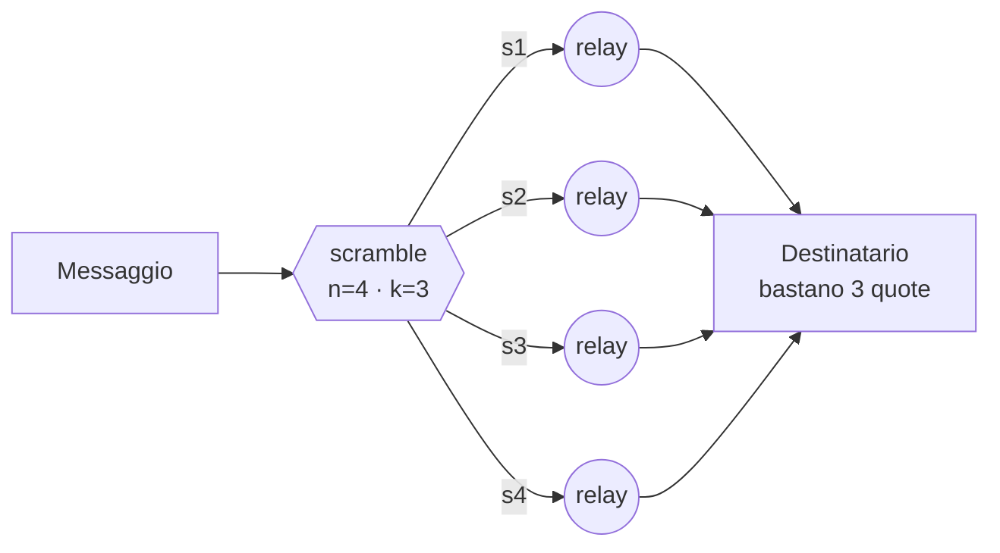

# ScrambNet

*Una rete anonima che non chiede atti di fede: né nella segretezza degli algoritmi, né nella loro robustezza computazionale, né in alcuna parte centrale.*

[English](README.md) · **[Italiano](README.it.md)** · [Español](README.es.md) · [Deutsch](README.de.md) · [Français](README.fr.md) · [中文](README.zh-CN.md)

**Stato: pre-alpha.** Un modello di minaccia, una specifica di protocollo in crescita e una proof-of-concept eseguibile — non ancora un sistema con cui proteggere segreti veri. Questo repository è il punto d'incontro per chi vuole costruirla, e attaccarla. Vedi [come si colloca](COMPARISON.md) e [come segnalare una falla](SECURITY.md).

## Tre rifiuti

Quasi tutte le reti anonime poggiano su tre gambe di fiducia. ScrambNet è progettata per toglierle tutte e tre:

1. **Nessuna segretezza del progetto.** Il principio di Kerckhoffs preso alla lettera: specifica pubblica in stile RFC, codice open source, build riproducibili. L'avversario può leggere ogni riga; la sicurezza sta nelle chiavi degli utenti e nella forma della rete.
2. **Nessuna dipendenza dalla difficoltà computazionale.** «Decifrarlo costerebbe miliardi di anni» è una promessa sulla pigrizia dell'universo, e promesse così hanno una storia di scadenze (DES, RC4, SHA-1 — e all'orizzonte i computer quantistici). Il muro portante non deve scadere.
3. **Nessun punto unico da sequestrare.** Niente directory authority, nessun server indispensabile, nessuna chiave di aggiornamento in mano a uno solo. Il kill switch non è vietato: è inesistente.

## L'idea centrale: la forza della dispersione

Ogni messaggio viene scomposto con lo schema di Shamir in `n` quote tali che `k` qualsiasi lo ricostruiscono e `k−1` sono **matematicamente indistinguibili dal rumore** — non difficili da decifrare: vuote. Le quote viaggiano su percorsi disgiunti: guardie diverse, giurisdizioni diverse, all'occorrenza trasporti diversi (una quota dentro un normale flusso TLS, una dentro quella che sembra una videochiamata, una sulla mesh locale).



Leggere il traffico smette di essere un problema di crittoanalisi e diventa un problema di occupazione fisica: all'avversario servono `k` punti della rete, posseduti nello stesso istante. La cifratura a cipolla resta, declassata a seconda cintura: se un giorno cade, la rete non diventa leggibile — diventa solo meno comoda.

Il prezzo è dichiarato in partenza: `n` quote costano `n` volte la banda. È lo scambio che questo paradigma propone: efficienza in cambio di una sicurezza senza ipotesi.

## L'architettura in breve

| Strato | Nome | Cosa fa |
|---|---|---|
| L0 | Identità | Chiavi generate sul dispositivo. Nessuna registrazione, nessun telefono, nessuna email. Un'identità che nessuno rilascia è un'identità che nessuno può revocare. |
| L1 | Scoperta | Niente directory authority. Gossip di liste firmate dai relay stessi; ogni client conosce un campione verificabile (cfr. Walking Onions). I nuovi utenti entrano lungo il grafo sociale (cfr. Lox di Tor). |
| L2 | Instradamento | Un circuito a cipolla per quota: 3 salti, pacchetti Sphinx a dimensione fissa, guardie stabili. Due marce: veloce (latenza da navigazione) e paranoica (mixnet con ritardi e traffico di copertura). |
| L3 | Trasporto | Involucri camaleonte: il traffico imita TLS qualunque (uTLS, ECH) o videochiamate WebRTC. Bloccarlo deve costare al censore più di quanto gli renda. |
| L4 | Blackout | Quando spengono internet: mesh locale (Wi-Fi Direct, Bluetooth), store-and-forward. La rete degrada, non muore. |

Dettagli completi: [docs/architecture.md](docs/architecture.md) · Limiti dichiarati: [docs/threat-model.md](docs/threat-model.md) *(in inglese; le traduzioni sono benvenute)* · Specifica di protocollo: [docs/spec/](docs/spec/) · Posizionamento: [COMPARISON.md](COMPARISON.md)

## Esegui la proof-of-concept

Le parti portanti sono eseguibili, come una specifica che puoi attaccare:

```
cd poc
python3 dispersal.py      # dispersione k-su-n e la soglia I-2, per forza bruta
python3 rendezvous.py     # consegna via dead-drop e polling disciplinato
python3 network_sim.py    # un avversario a k-percorsi contro la dimensione della rete, in numeri
```

Pura libreria standard di Python, nessuna dipendenza, nessuna rete. È un
giocattolo per scelta (vedi [poc/README.md](poc/README.md)): non proteggerci
nulla. Il suo compito è rendere il progetto abbastanza concreto da poterlo rompere.

## Cosa non promette

Un osservatore globale passivo che vede tutto il traffico mondiale insieme batte la modalità veloce — lo stesso limite che Tor dichiara dal suo primo design paper. Solo la modalità paranoica (mixnet) lo affronta. Una rete che promette protezione totale sta mentendo, e chi rischia davvero merita di sapere esattamente dove finisce l'ombrello.

## Quasi niente da inventare

Shamir (1979), l'Information Dispersal di Rabin (1989), le DC-net di Chaum (1988), Sphinx (2009), Snowflake e Lox di Tor, il Noise Protocol Framework, Briar e Reticulum per il livello blackout, Walking Onions per la scoperta a campione. Il lavoro vero è di composizione e disciplina: se un dettaglio del progetto deve restare segreto per funzionare, quel dettaglio è un difetto.

## Roadmap

1. **Modello di minaccia** — pubblicato, e sotto attacco nelle [issue](../../issues). ✔ prima passata
2. **Specifica di protocollo** — pacchetto quota, record di gossip, rendezvous e selezione dei percorsi sono abbozzati ([docs/spec/](docs/spec/)); i trasporti camaleonte (Parte 4) e l'incapsulamento per il blackout (Parte 5) sono i prossimi.
3. **Proof-of-concept** — il nucleo di dispersione, la consegna via dead-drop e un simulatore d'avversario girano oggi in [poc/](poc/). ✔ prima passata
4. **Nodo di riferimento** — un nodo unico, piccolo e noioso, adatto ai telefoni (probabilmente in Rust), una volta assestata la selezione dei percorsi (Parte 3). L'anonimato che gira solo su un laptop nuovo non è per chi ne ha più bisogno.
5. **Client di riferimento** — un client di chat dimostrativo, una volta che esista un nodo a trasportarlo. Non prima: un client che promette ciò che la rete non può ancora offrire sarebbe l'opposto del non chiedere atti di fede.

## Contribuire

I contributi pseudonimi sono benvenuti e attesi — vedi [CONTRIBUTING.md](CONTRIBUTING.md). Per ora la discussione avviene nelle issue di questo repository. Le traduzioni della documentazione sono un ottimo primo contributo.

Una regola sopra tutte: **questa rete trasporta pacchetti, non opinioni.** Protegge i dissidenti e i loro avversari con la stessa matematica. Gli avversari politici non sono nemici, e un'infrastruttura è credibile solo se non può scegliere da che parte stare.

## Licenza

Specifica e documentazione: [CC0 1.0](LICENSE) (pubblico dominio). Il futuro codice sceglierà la sua licenza per consenso dei contributori.
