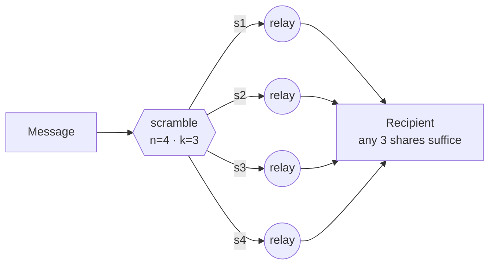

# ScrambNet

*An anonymity network that asks for no acts of faith — not in the secrecy of its algorithms, not in their computational strength, not in any central party.*

**[English](README.md)** · [Italiano](README.it.md) · [Español](README.es.md) · [Deutsch](README.de.md) · [Français](README.fr.md) · [中文](README.zh-CN.md)

**Status: pre-alpha.** A threat model, a growing wire specification, and a runnable proof-of-concept — not a system to protect real secrets with yet. This repository is the meeting point for people who want to build it, and to attack it. See [how it compares](docs/en/COMPARISON.md) and [how to report a break](docs/en/SECURITY.md).

## Three refusals

Most anonymity networks stand on three legs of trust. ScrambNet is designed to remove all three:

1. **No secrecy of design.** Kerckhoffs's principle, taken literally: public RFC-style specification, open source, reproducible builds. The adversary may read every line; security lives in user keys and in the shape of the network.
2. **No reliance on computational hardness.** "Breaking this would take billions of years" is a promise about the universe's laziness, and such promises have a history of expiring (DES, RC4, SHA-1 — and quantum computers are on the horizon). The load-bearing wall must not expire.
3. **No single point to seize.** No directory authorities, no indispensable server, no update key held by one party. The kill switch is not forbidden; it is nonexistent.

## The core idea: strength from dispersal

Every message is split with Shamir secret sharing into `n` shares such that any `k` reconstruct it and `k−1` are **mathematically indistinguishable from noise** — not hard to decrypt: empty. The shares travel over disjoint paths: different guards, different jurisdictions, when needed different transports (one share inside an ordinary TLS flow, one inside what looks like a video call, one over local mesh).



Reading the traffic stops being a cryptanalysis problem and becomes a problem of physical occupation: the adversary must hold `k` points of the network at the same instant. Onion encryption remains, demoted to a second belt — if it ever falls, the network does not become readable; it becomes less convenient.

The cost is declared up front: `n` shares cost `n×` the bandwidth. That is the trade this paradigm proposes — efficiency in exchange for security without assumptions.

## Architecture at a glance

| Layer | Name | What it does |
|---|---|---|
| L0 | Identity | Keypairs generated on-device. No registration, no phone number, no e-mail. An identity nobody issues is an identity nobody can revoke. |
| L1 | Discovery | No directory authorities. Gossip of self-signed relay lists; each client holds a verifiable sample (cf. Walking Onions). New users enter along the social graph (cf. Tor's Lox). |
| L2 | Routing | Per-share onion circuits: 3 hops, fixed-size Sphinx packets, long-lived guards. Two gears: fast (browsing latency) and paranoid (mixnet with delays and cover traffic). |
| L3 | Transport | Chameleon wrappers: the traffic imitates ordinary TLS (uTLS, ECH) or WebRTC calls. Blocking it must cost the censor more than it earns. |
| L4 | Blackout | When the internet is switched off: local mesh (Wi-Fi Direct, Bluetooth), store-and-forward. The network degrades; it does not die. |

Full details: [architecture](docs/en/architecture.md) · Honest limits: [threat model](docs/en/threat-model.md) · Wire spec: [docs/en/spec/](docs/en/spec/) · Positioning: [COMPARISON](docs/en/COMPARISON.md) · Roadmap: [ROADMAP](docs/en/ROADMAP.md)

All documentation in six languages: [English](docs/en/) · [Italiano](docs/it/) · [Español](docs/es/) · [Deutsch](docs/de/) · [Français](docs/fr/) · [中文](docs/zh-CN/)

## Run the proof-of-concept

The load-bearing parts are executable, as a specification you can attack:

```
cd poc
python3 dispersal.py      # k-of-n dispersal and the I-2 floor, by brute force
python3 rendezvous.py     # dead-drop delivery and disciplined polling
python3 network_sim.py    # a k-path adversary vs network size, in numbers
```

Pure Python standard library, no dependencies, no network. It is a toy by
design (see [poc/README.md](poc/README.md)): do not protect anything with it.
Its job is to make the design concrete enough to break.

## What it does not promise

A global passive adversary that watches all traffic at once defeats the fast mode — the same limit Tor has declared since its first design paper. Only the paranoid (mixnet) mode addresses it. A network that promises total protection is lying, and the people who run real risks deserve to know exactly where the umbrella ends.

## Almost nothing to invent

Shamir (1979), Rabin's Information Dispersal (1989), Chaum's DC-nets (1988), Sphinx (2009), Tor's Snowflake and Lox, the Noise Protocol Framework, Briar and Reticulum for the blackout layer, Walking Onions for sampled discovery. The real work is composition and discipline: if any detail of the design must stay secret for the system to work, that detail is a defect.

## Roadmap

1. **Threat model** — published, and under attack in the [issues](../../issues). ✔ first pass
2. **Wire specification** — share packet, gossip record, rendezvous and path selection are drafted ([docs/en/spec/](docs/en/spec/)); chameleon transports (Part 4) and blackout framing (Part 5) are next.
3. **Proof-of-concept** — the dispersal core, dead-drop delivery, and an adversary simulator run today in [poc/](poc/). ✔ first pass
4. **Reference node** — one small, boring node, mobile-capable (likely Rust), once path selection (Part 3) settles. Anonymity that only runs on a new laptop is not for the people who need it most.
5. **Reference client** — a demonstrative chat client, once there is a node to carry it. Not before: a client that promises what the network cannot yet deliver would be the opposite of asking for no acts of faith.

## Contributing

Pseudonymous contributions are welcome and expected — see [CONTRIBUTING.md](docs/en/CONTRIBUTING.md). Discussion happens in the issues of this repository for now. Translations of the documentation are a valued first contribution.

One rule above all: **this network carries packets, not opinions.** It protects dissidents and their opponents with the same mathematics. Political adversaries are not enemies, and an infrastructure is credible only if it cannot choose sides.

## License

Specification and documentation: [CC0 1.0](LICENSE) (public domain). Future code will choose its license by contributor consensus.
