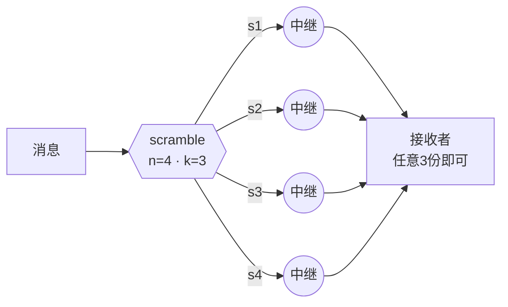

# ScrambNet

*一个不要求任何信仰的匿名网络：不依赖算法的保密性，不依赖算法的计算强度，也不依赖任何中心机构。*

[English](README.md) · [Italiano](README.it.md) · [Español](README.es.md) · [Deutsch](README.de.md) · [Français](README.fr.md) · **[中文](README.zh-CN.md)**

**状态：pre-alpha（预览前期）。** 一个威胁模型、一份不断扩充的协议规范，以及一个可运行的概念验证——还不是一个可以用来保护真实秘密的系统。这个仓库是愿意参与建设者、以及愿意攻击它的人的聚集点。参见[它如何比较](docs/zh-CN/COMPARISON.md)与[如何报告漏洞](docs/zh-CN/SECURITY.md)。

## 三个拒绝

几乎所有匿名网络都站在三条信任之腿上。ScrambNet 的设计目标是把三条全部去掉：

1. **不依赖设计的保密。** 严格遵循柯克霍夫原则：RFC 风格的公开规范、开源代码、可复现构建。对手可以阅读每一行；安全性存在于用户的密钥和网络的形态之中。
2. **不依赖计算难度。** 「破解它需要几十亿年」是一个关于宇宙之懒惰的承诺，而这类承诺历来会过期（DES、RC4、SHA-1——量子计算机也已在地平线上）。承重墙不应过期。
3. **没有可被查封的单点。** 没有目录权威，没有不可或缺的服务器，没有掌握在单一一方手中的更新密钥。终止开关不是被禁止——而是不存在。

## 核心思想：来自分散的力量

每条消息用 Shamir 秘密共享拆分为 `n` 份，任意 `k` 份即可重建，而 `k−1` 份**在数学上与噪声不可区分**——不是难以解密，而是空无一物。各份额经由互不相交的路径传输：不同的守卫节点、不同的司法辖区，必要时甚至不同的传输方式（一份藏在普通的 TLS 流中，一份藏在看似视频通话的流量中，一份走本地网状网络）。



读取流量不再是密码分析问题，而变成物理占领问题：对手必须在同一时刻掌握网络中的 `k` 个节点。洋葱加密依然保留，但降级为第二道防线：即使有一天它被攻破，网络也不会变得可读——只是变得不那么方便。

代价预先声明：`n` 份意味着 `n` 倍的带宽。这就是此范式提出的交换：用效率换取不依赖任何假设的安全。

## 架构一览

| 层 | 名称 | 职责 |
|---|---|---|
| L0 | 身份 | 密钥对在设备上生成。无需注册、无需电话号码、无需邮箱。无人颁发的身份，也就无人能够吊销。 |
| L1 | 发现 | 没有目录权威。中继自签名列表通过 gossip 传播；每个客户端只持有一份可验证的抽样（参见 Walking Onions）。新用户沿社交图谱进入（参见 Tor 的 Lox）。 |
| L2 | 路由 | 每个份额走独立的洋葱链路：3 跳、定长 Sphinx 数据包、长期稳定的守卫节点。两档模式：快速档（浏览级延迟）与偏执档（带延迟与掩护流量的混合网络）。 |
| L3 | 传输 | 变色龙外壳：流量模仿普通 TLS（uTLS、ECH）或 WebRTC 通话。封锁它的代价必须高于审查者的收益。 |
| L4 | 断网 | 当互联网被切断时：本地网状网络（Wi-Fi Direct、蓝牙）、存储转发。网络只会降级，不会死亡。 |

完整细节：[docs/zh-CN/architecture.md](docs/zh-CN/architecture.md) · 坦诚的局限：[docs/zh-CN/threat-model.md](docs/zh-CN/threat-model.md) · 协议规范：[docs/zh-CN/spec/](docs/zh-CN/spec/) · 定位对照：[COMPARISON](docs/zh-CN/COMPARISON.md)

## 运行概念验证

承重的部分都是可运行的，是一份你可以攻击的规范：

```
cd poc
python3 dispersal.py      # k-of-n 分散与 I-2 下界，以暴力穷举验证
python3 rendezvous.py     # 死信箱投递与有纪律的轮询
python3 network_sim.py    # k-路径对手对阵网络规模，用数字说话
```

纯 Python 标准库，无依赖，无网络。它是有意为之的玩具（见
[poc/README.md](poc/README.md)）：别拿它保护任何东西。它的职责是把设计变得
足够具体，好让人去攻破。

## 它不承诺什么

能够同时监视全球所有流量的全局被动观察者可以击败快速档——这与 Tor 在其最初设计论文中声明的局限相同。只有偏执档（混合网络）才能应对它。承诺全面保护的网络是在撒谎，而真正承担风险的人有权确切知道保护伞的边界在哪里。

## 几乎无需发明

Shamir（1979）、Rabin 的信息分散算法（1989）、Chaum 的 DC 网络（1988）、Sphinx（2009）、Tor 的 Snowflake 与 Lox、Noise 协议框架、用于断网层的 Briar 与 Reticulum、用于抽样发现的 Walking Onions。真正的工作在于组合与纪律：如果设计中的任何细节必须保密系统才能运作，那个细节就是缺陷。

## 路线图

1. **威胁模型** —— 已发布，并正在 [issues](../../issues) 中接受攻击。✔ 第一轮
2. **协议规范** —— 份额数据包、gossip 记录、会合与路径选择已有草稿（[docs/zh-CN/spec/](docs/zh-CN/spec/)）；变色龙传输（第 4 部分）与断网封装（第 5 部分）是接下来的工作。
3. **概念验证** —— 分散核心、死信箱投递与一个对手模拟器，如今都已在 [poc/](poc/) 中运行。✔ 第一轮
4. **参考节点** —— 一个小而乏味的节点，支持移动端（很可能用 Rust），待路径选择（第 3 部分）尘埃落定后开始。只能在崭新笔记本上运行的匿名工具，帮不到最需要它的人。
5. **参考客户端** —— 一个示范性的聊天客户端，待有节点可承载它之后再做。不会更早：一个承诺网络尚无法兑现之物的客户端，恰恰与「不要求任何信仰」背道而驰。

## 参与贡献

欢迎并期待化名贡献——见 [CONTRIBUTING.md](docs/zh-CN/CONTRIBUTING.md)。目前讨论在本仓库的 issues 中进行。翻译文档是一种极受重视的首次贡献。

最重要的一条规则：**这个网络传输的是数据包，不是观点。** 它用同一套数学保护异见者及其对手。政治对手不是敌人，而一个基础设施只有在无法选边站队时才值得信任。

## 许可证

规范与文档：[CC0 1.0](LICENSE)（公有领域）。未来的代码将由贡献者共识决定其许可证。
