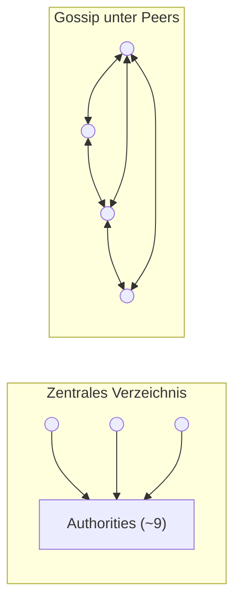
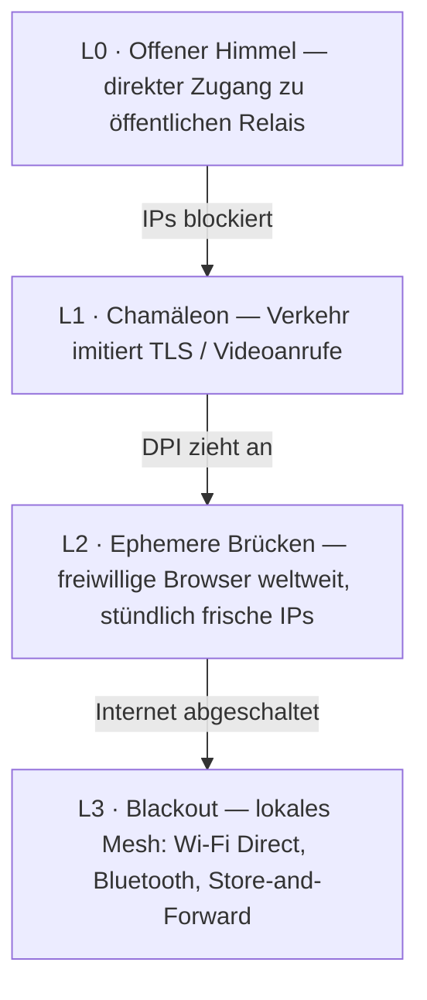

# ScrambNet — Architektur

> Arbeitsentwurf. Alles hier steht dem Angriff offen: Öffne ein Issue gegen jede Behauptung.
> Die Entwurfsmaxime ist Shannons: **„Der Feind kennt das System."** Muss irgendein Detail geheim
> bleiben, damit das Netz funktioniert, dann ist dieses Detail ein Fehler.

ScrambNet schichtet fünf Mechanismen. Jeder nimmt an, dass die Schichten darunter feindlich oder nicht vorhanden sind.

## L0 — Identität ohne Register

Eine Identität ist ein Schlüsselpaar, das auf dem Gerät erzeugt wird. Es gibt keinen Registrierungsschritt, keine
Telefonnummer, keine E-Mail-Adresse, nirgendwo eine Kontodatenbank. Folgen:

- Es gibt keine Nutzerliste, weil es keinen Moment gibt, in dem sich ein Nutzer anmeldet.
- Eine Identität, die niemand ausstellt, kann niemand widerrufen, vorladen oder verkaufen.
- Schlüsselmaterial verlässt nie das Gerät; das Gerät zu verlieren bedeutet, die Identität zu verlieren
  (soziale Wiederherstellung über `k`-von-`n`-Anteile in den Händen gewählter Freunde ist ein offener
  Entwurfspunkt — dieselbe Streuungsprimitive, die das Netz ohnehin nutzt).

## L1 — Entdeckung ohne Zentrum

Der ernste einzelne Punkt in den heute eingesetzten Anonymitätsnetzen ist die Entdeckung. Tor-Clients
holen einen Netzkonsens, der von weniger als zehn Directory Authorities mit bekannten,
fest kodierten Adressen erzeugt wird. Sie werden ehrenhaft betrieben — und bleiben ein Ziel: blockiere
sie alle, und neue Clients sind blind.

ScrambNet ersetzt das Zentrum durch drei Mechanismen:

1. **Selbstsignierte Relais-Einträge.** Jedes Relais veröffentlicht einen Eintrag (Adresse, Schlüssel, Transporte,
   Bandbreitenbehauptung), signiert mit seinem eigenen Schlüssel. Ein bösartiger Knoten kann über sich selbst lügen; er kann
   nicht über andere lügen.
2. **Gossip mit überprüfbarer Stichprobe.** Clients halten nicht die vollständige Netzkarte. Jeder
   Client hält eine Stichprobe, die er überprüfen kann, mit Peers ausgetauscht — der Forschungslinie folgend,
   die *Walking Onions* (Komlo, Mathewson, Goldberg) eröffnet hat und die genau dazu existiert,
   Tor dieses Gewicht abzunehmen.
3. **Brücken-Verteilung über den sozialen Graphen.** Wo das offene Netz blockiert ist, werden Eintrittspunkte
   von Person zu Person entlang des sozialen Graphen weitergereicht, mit Vertrauensstufen, die mit der
   Zeit wachsen, wie in Tors *Lox*. Ein Zensor kann sich als ein Nutzer ausgeben; er kann sich nicht als
   der Freund aller ausgeben.

Offene Probleme: Eclipse-Angriffe auf die Stichprobe, Sybil-Resistenz ohne zentralen Zuteiler,
Bootstrap für einen Nutzer mit null Kontakten. Siehe [threat-model.md](threat-model.md#offene-probleme).

## L2 — Routing: zuerst Streuung, dann Zwiebeln

### Die tragende Wand: `k`-von-`n`-Streuung

Jede Nachricht wird mit Shamirs Secret Sharing (1979) in `n` Anteile zerlegt; beliebige `k`
rekonstruieren sie; beliebige `k−1` sind statistisch nicht von Zufallsrauschen zu unterscheiden. Dies ist
informationstheoretisch, nicht rechnerisch: Ein Gegner mit `k−1` Anteilen und unbegrenzter Rechenleistung
hält nichts in Händen, weil nichts da ist. Das Regime ist entscheidend und wird klar benannt: Diese
bedingungslose Garantie ist die Untergrenze *unterhalb* von `k` Anteilen. Bei oder oberhalb von `k`
setzt ein Gegner den Geheimtext wieder zusammen und steht dann dem Ende-zu-Ende-AEAD gegenüber — ein
rechnerischer Gürtel, keine zweite informationstheoretische Wand (Spec SP-1/SP-1a). Die Wette des
Projekts ist, dass die Untergrenze unter diesem Gürtel nicht ablaufen kann, nicht dass der Gürtel
unzerbrechlich wäre.

Die Anteile reisen über **disjunkte Pfade**: verschiedene Wächter, Pfade so gewählt, dass sie keine
autonomen Systeme und Jurisdiktionen teilen, und — wenn der Client es des Preises wert hält —
gänzlich verschiedene Transporte (ein Anteil über TLS, einer über einen WebRTC-geformten Fluss, einer über
das lokale Mesh).

Was das konkret einbringt:

- **Vertraulichkeit ohne Annahmen.** Eine Nachricht zu lesen erfordert, physisch `k` Netzpositionen
  im selben Augenblick zu halten. Das ist ein Besetzungsproblem, kein
  Kryptoanalyse-Problem, und es wird nicht schwächer, während die Mathematik voranschreitet.
- **Fehlertoleranz gratis.** `k < n` bedeutet, dass `n − k` Pfade ausfallen oder blockiert werden können, ohne
  die Nachricht zu verlieren.
- **Ein ausgewiesener Preis.** `n` Anteile kosten die `n`-fache Bandbreite. Die Standardwerte (`n = 4, k = 3`
  für Messaging; `n = 2, k = 2` plus FEC für Massenflüsse?) sind eine offene Abstimmungsfrage.

### Der zweite Gürtel: leichte Zwiebel-Circuits

Jeder Anteil reist in seinem eigenen Zwiebel-Circuit: 3 Hops, schichtweise Verschlüsselung, sodass kein
Relais mehr sieht als seinen Vorgänger und Nachfolger. Die Pakete nutzen das **Sphinx**-Format (Danezis &
Goldberg, 2009): feste Größe an jedem Hop, sodass die Position im Pfad nicht beobachtbar ist.
Die Primitiven sind absichtlich langweilig und schnell auf einem billigen Telefon: X25519, ChaCha20-Poly1305,
Handshakes aus dem Noise Protocol Framework.

Fällt diese ganze rechnerische Schicht eines Tages, wird das Netz nicht lesbar —
der Gegner ist immer noch unter `k` gleichzeitigen Positionen. Es wird nur unbequemer.

### Zwei Gänge

- **Schnell:** 3 Hops pro Anteil, kein Mixen. Browsing-Latenz. Anfällig für Ende-zu-Ende-
  Timing-Korrelation durch einen Gegner, der `k` Pfade an beiden Enden beobachtet.
- **Paranoid:** dieselben Sphinx-Pakete treten in ein Mixnet mit Hop-weisen Verzögerungen und Decktraffic
  ein, für die Quelle, die mit einem Journalisten spricht und Sekunden gegen Widerstandsfähigkeit
  gegen Timing-Analyse eintauschen kann.

## L3 — Transport: das Chamäleon

Moderne Zensoren lesen keinen Inhalt; sie gleichen Fingerabdrücke ab. Jedes Protokoll hat einen
charakteristischen Handshake, erkennbar in wenigen Paketen DPI. Die Antwort ist, keinen
eigenen Fingerabdruck zu haben: einsteckbare Hüllen, die gewöhnliches TLS imitieren (Browser-Fingerabdruck
über uTLS, Servernamen durch ECH verborgen) oder einen gewöhnlichen WebRTC-Anruf. Das Ziel ist
ökonomisch: Die Hülle zu blockieren muss bedeuten, den Handel zu blockieren, der über dieselben Protokolle läuft —
nicht „du kannst mich nicht blockieren", sondern „mich zu blockieren kostet dich mehr, als es dir einbringt".

## L4 — Blackout: das Netz degradiert, es stirbt nicht

Der Grenzfall, der das Projekt motiviert: Ein Regime schaltet das Internet in einer Region ab.
Ein reines Overlay-Netz stirbt dort. ScrambNet steigt stattdessen eine Leiter hinab:

Im Blackout-Modus hüpfen Nachrichten von Gerät zu Gerät über Wi-Fi Direct und Bluetooth und warten in
der Schlange, bis irgendein Gerät eine Route nach draußen zurückgewinnt (Store-and-Forward), wie Briar und
Reticulum bereits auf echter Hardware zeigen. Eine Nachricht kann eine Stadt mit der Geschwindigkeit eines Busses
durchqueren — was unendlich besser ist als null. Die Streuung gilt weiter: Anteile können verschiedene physische
Träger nehmen.

## Wer betreibt was — Teilnahmerollen

Die Zustellung zielt nie auf eine Person: Empfänger halten Kontaktkarten je Beziehung
und sammeln Anteile aus verstreuten Dead-Drops, hinter ihren eigenen Circuits
(Spec Teil 6). Darum herum liegt ein Spektrum von Rollen, jede gewählt,
keine verpflichtend:

- **Reiner Client** — nahezu unsichtbar, für Menschen an Orten, wo die Teilnahme
  selbst gefährlich ist; reitet auf Brücken und Chamäleon-Transporten.
- **Relais + Nutzer** — das natürliche Rückgrat, wo das Risiko gering ist: Transitverkehr
  ist kostenlose Deckung für den eigenen Verkehr, die Kapazität wächst mit der Nutzung. Der Preis ist eine
  veröffentlichte Adresse; die Disziplin ist ein stets aktiver Zeitplan, denn ein Relais,
  das genau dann online ist, wenn sein Betreiber chattet, ist ein Schnittmengenangriff auf
  sich selbst.
- **Reines Relais / Drop** — der Freiwillige in einer sicheren Jurisdiktion, der für die trägt und
  speichert, die keine haben. Messaging-Verkehr hat keinen Clear-Web-Ausgang: ein
  Relais leitet Rauschen fester Größe weiter, und ein Drop speichert Anteile, die es weder lesen noch
  verknüpfen kann, was die Exposition des Freiwilligen strukturell geringer hält als die eines
  Tor-Ausgangs.
- **Mesh-Knoten / Gateway** — stets eine ausdrückliche Zustimmung, denn seine Sichtbarkeit
  ist physisch, auf Nachbarschaftsmaßstab.

Niemand muss sichtbar sein, um teilzunehmen; niemand bezahlt für die, die sich
Sichtbarkeit nicht leisten können. Der vorgeschlagene Standard für die Sicheren ist beizutragen.

## Vorarbeit, die dieser Entwurf komponiert

| Baustein | Jahr | Rolle hier |
|---|---|---|
| Shamirs Secret Sharing | 1979 | Die tragende Wand: bedingungslose Streuung |
| Rabins Information Dispersal | 1989 | Platzsparende Streuung für Massendaten |
| Chaums DC-Netze | 1988 | Referenzpunkt für bedingungslose Anonymität in kleinen Gruppen |
| Sphinx-Paketformat | 2009 | Positionsverbergende Pakete fester Größe |
| Noise Protocol Framework | 2016 | Handshakes (wie in WireGuard) |
| uTLS / ECH | — | Fingerabdruck-Tarnung |
| Snowflake, Lox (Tor) | — | Ephemere Brücken; Verteilung über den sozialen Graphen |
| Walking Onions | 2020 | Entdeckung per überprüfbarer Stichprobe |
| Briar, Reticulum | — | Beweis, dass die Blackout-Schicht auf echter Hardware funktioniert |
| Pond, Loopix | 2015–2017 | Dead-Drops und Anbieter-Postfächer — das Zustellmuster, das Teil 6 verstreut |

Der Beitrag ist keine neue Primitive. Er ist eine Komposition, in der die Primitive, die
nicht ablaufen kann, die Last trägt, und alles, was ablaufen kann, eine Bequemlichkeit ist.
