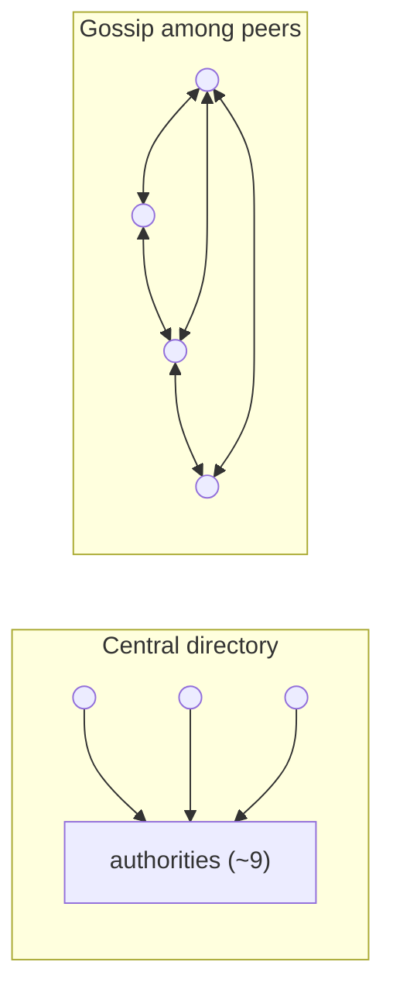
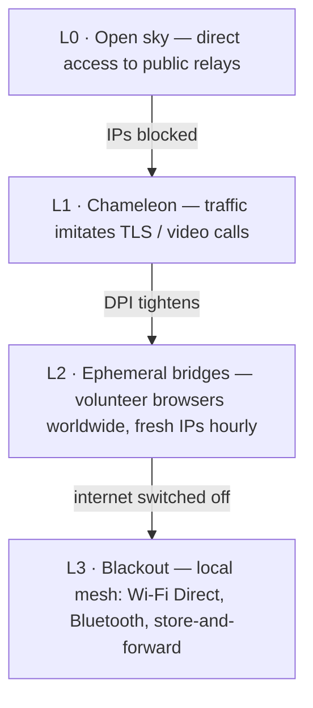

# ScrambNet — Architecture

> Working draft. Everything here is open for attack: open an issue against any claim.
> The design maxim is Shannon's: **"the enemy knows the system."** If any detail must stay
> secret for the network to work, that detail is a defect.

ScrambNet layers five mechanisms. Each one assumes the layers below it are hostile or absent.

## L0 — Identity without a registry

An identity is a keypair generated on the device. There is no registration step, no phone
number, no e-mail address, no account database anywhere. Consequences:

- There is no list of users, because there is no moment at which a user signs up.
- An identity nobody issues is an identity nobody can revoke, subpoena, or sell.
- Key material never leaves the device; losing the device means losing the identity
  (social recovery via `k`-of-`n` shares held by chosen friends is an open design item —
  the same dispersal primitive the network already uses).

## L1 — Discovery without a center

The serious single point in today's deployed anonymity networks is discovery. Tor clients
fetch a network consensus produced by fewer than ten directory authorities with well-known,
hard-coded addresses. They are run honorably — and they remain a target: block them all and
new clients are blind.

ScrambNet replaces the center with three mechanisms:

1. **Self-signed relay records.** Each relay publishes a record (address, keys, transports,
   bandwidth claim) signed by its own key. A malicious node can lie about itself; it cannot
   lie about others.
2. **Gossip with verifiable sampling.** Clients do not hold the full network map. Each
   client holds a sample it can verify, exchanged with peers — following the line of
   research opened by *Walking Onions* (Komlo, Mathewson, Goldberg), which exists precisely
   to remove this weight from Tor.
3. **Social-graph bridge distribution.** Where the open network is blocked, entry points
   are handed person-to-person along the social graph, with trust levels that grow over
   time, as in Tor's *Lox*. A censor can pose as one user; it cannot pose as everyone's friend.

Open problems: eclipse attacks on sampling, sybil resistance without a central allocator,
bootstrap for a user with zero contacts. See [threat-model.md](threat-model.md#open-problems).

## L2 — Routing: dispersal first, onions second

### The load-bearing wall: `k`-of-`n` dispersal

Every message is split with Shamir secret sharing (1979) into `n` shares; any `k`
reconstruct it; any `k−1` are statistically indistinguishable from random noise. This is
information-theoretic, not computational: a `k−1`-share adversary with unlimited computing
power holds nothing, because nothing is there. The regime matters and is stated plainly:
this unconditional guarantee is the floor *below* `k` shares. At or above `k` an adversary
reassembles the ciphertext and then faces the end-to-end AEAD — a computational belt, not a
second information-theoretic wall (spec SP-1/SP-1a). The project's wager is that the floor
beneath that belt cannot expire, not that the belt is unbreakable.

Shares travel over **disjoint paths**: different guard nodes, paths chosen to avoid sharing
autonomous systems and jurisdictions, and — when the client deems it worth the cost —
different transports entirely (one share over TLS, one over a WebRTC-shaped flow, one over
the local mesh).

What this buys, concretely:

- **Confidentiality without assumptions.** Reading a message requires physically holding
  `k` network positions at the same instant. That is an occupation problem, not a
  cryptanalysis problem, and it does not weaken as mathematics advances.
- **Fault tolerance for free.** `k < n` means `n − k` paths can fail or be blocked without
  losing the message.
- **A declared cost.** `n` shares cost `n×` bandwidth. Defaults (`n = 4, k = 3` for
  messaging; `n = 2, k = 2` plus FEC for bulk flows?) are an open tuning question.

### The second belt: light onion circuits

Each share travels inside its own onion circuit: 3 hops, layered encryption, so no relay
sees more than its predecessor and successor. Packets use the **Sphinx** format (Danezis &
Goldberg, 2009): fixed size at every hop, so position in the path is not observable.
Primitives are deliberately boring and fast on a cheap phone: X25519, ChaCha20-Poly1305,
handshakes from the Noise Protocol Framework.

If all of this computational layer someday falls, the network does not become readable —
the adversary is still short of `k` simultaneous positions. It becomes less convenient.

### Two gears

- **Fast:** 3 hops per share, no mixing. Browsing-grade latency. Vulnerable to end-to-end
  timing correlation by an adversary watching `k` paths at both ends.
- **Paranoid:** the same Sphinx packets enter a mixnet with per-hop delays and cover
  traffic, for the source talking to a journalist who can trade seconds for resistance
  to timing analysis.

## L3 — Transport: the chameleon

Modern censors do not read content; they match fingerprints. Every protocol has a
characteristic handshake, recognizable in a few packets of DPI. The answer is to have no
fingerprint of one's own: pluggable wrappers that imitate ordinary TLS (browser fingerprint
via uTLS, server names hidden by ECH) or an ordinary WebRTC call. The goal is economic:
blocking the wrapper must mean blocking the commerce that runs over the same protocols —
not "you cannot block me" but "blocking me costs more than it earns you."

## L4 — Blackout: the network degrades, it does not die

The limit case that motivates the project: a regime switches off the internet in a region.
An overlay-only network dies there. ScrambNet descends a ladder instead:

In blackout mode, messages hop device-to-device over Wi-Fi Direct and Bluetooth and queue
until any device regains a route out (store-and-forward), as Briar and Reticulum already
demonstrate on real hardware. A message can cross a city at the speed of a bus — which is
infinitely better than zero. Dispersal still applies: shares can take different physical
carriers.

## Who runs what — participation roles

Delivery never targets a person: recipients hold per-relationship contact cards
and collect shares from dispersed dead drops, from behind their own circuits
(spec Part 6). Around that sits a spectrum of roles, every one of them chosen,
none required:

- **Pure client** — near-invisible, for people in places where participating is
  itself dangerous; rides bridges and chameleon transports.
- **Relay + user** — the natural backbone where the risk is low: transit traffic
  is free cover for one's own traffic, capacity grows with use. The price is a
  published address; the discipline is an always-on schedule, because a relay
  that is up exactly when its operator chats is an intersection attack on
  itself.
- **Pure relay / drop** — the volunteer in a safe jurisdiction carrying and
  storing for those who are not. Messaging traffic has no clear-web exit: a
  relay forwards fixed-size noise and a drop stores shares it cannot read or
  link, which keeps the volunteer's exposure structurally lower than a Tor
  exit's.
- **Mesh node / gateway** — always an explicit opt-in, because its visibility
  is physical, at neighborhood scale.

Nobody must be visible to participate; nobody pays for those who cannot afford
visibility. The suggested default for the safe is to contribute.

## Prior art this design composes

| Piece | Year | Role here |
|---|---|---|
| Shamir secret sharing | 1979 | The load-bearing wall: unconditional dispersal |
| Rabin Information Dispersal | 1989 | Space-efficient dispersal for bulk data |
| Chaum DC-nets | 1988 | Reference point for unconditional anonymity in small groups |
| Sphinx packet format | 2009 | Fixed-size, position-hiding packets |
| Noise Protocol Framework | 2016 | Handshakes (as in WireGuard) |
| uTLS / ECH | — | Fingerprint camouflage |
| Snowflake, Lox (Tor) | — | Ephemeral bridges; social-graph distribution |
| Walking Onions | 2020 | Discovery by verifiable sample |
| Briar, Reticulum | — | Proof the blackout layer works on real hardware |
| Pond, Loopix | 2015–2017 | Dead drops and provider mailboxes — the delivery pattern Part 6 disperses |

The contribution is not a new primitive. It is a composition in which the primitive that
cannot expire carries the load, and everything that can expire is a convenience.
