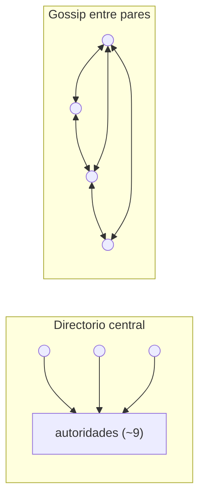
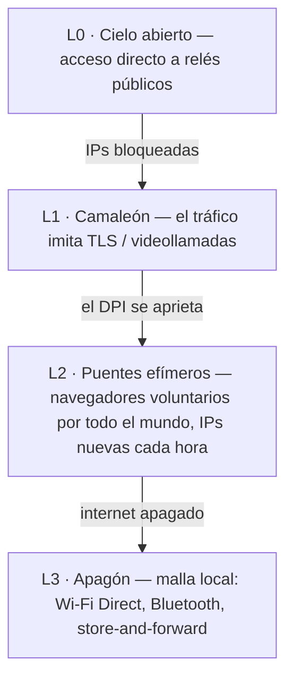

# ScrambNet — Arquitectura

> Borrador de trabajo. Todo lo que hay aquí está abierto al ataque: abre una issue contra cualquier afirmación.
> La máxima de diseño es la de Shannon: **«el enemigo conoce el sistema».** Si algún detalle debe permanecer
> secreto para que la red funcione, ese detalle es un defecto.

ScrambNet superpone cinco mecanismos. Cada uno supone que las capas por debajo son hostiles o inexistentes.

## L0 — Identidad sin registro

Una identidad es un par de claves generado en el dispositivo. No hay paso de registro, ni número de
teléfono, ni dirección de correo, ni base de datos de cuentas en ninguna parte. Consecuencias:

- No hay lista de usuarios, porque no existe un momento en que un usuario se dé de alta.
- Una identidad que nadie emite es una identidad que nadie puede revocar, requerir judicialmente ni vender.
- El material de claves nunca sale del dispositivo; perder el dispositivo significa perder la identidad
  (la recuperación social mediante partes `k`-de-`n` en manos de amigos elegidos es un asunto de diseño
  abierto — la misma primitiva de dispersión que la red ya usa).

## L1 — Descubrimiento sin centro

El punto único serio en las redes de anonimato desplegadas hoy es el descubrimiento. Los clientes de Tor
descargan un consenso de red producido por menos de diez autoridades de directorio con direcciones
conocidas y codificadas de forma rígida. Se gestionan con honradez — y siguen siendo un objetivo:
bloquéalas todas y los nuevos clientes quedan ciegos.

ScrambNet sustituye el centro por tres mecanismos:

1. **Registros de relé autofirmados.** Cada relé publica un registro (dirección, claves, transportes,
   afirmación de ancho de banda) firmado con su propia clave. Un nodo malicioso puede mentir sobre sí mismo;
   no puede mentir sobre los demás.
2. **Gossip con muestreo verificable.** Los clientes no guardan el mapa completo de la red. Cada
   cliente guarda una muestra que puede verificar, intercambiada con los pares — siguiendo la línea de
   investigación abierta por *Walking Onions* (Komlo, Mathewson, Goldberg), que existe precisamente
   para quitarle a Tor este peso.
3. **Distribución de puentes por el grafo social.** Allí donde la red abierta está bloqueada, los puntos
   de entrada se pasan de persona a persona a lo largo del grafo social, con niveles de confianza que
   crecen con el tiempo, como en el *Lox* de Tor. Un censor puede hacerse pasar por un usuario; no puede
   hacerse pasar por el amigo de todos.

Problemas abiertos: ataques de eclipse sobre el muestreo, resistencia a sybil sin asignador central,
arranque para un usuario con cero contactos. Ver [threat-model.md](threat-model.md#problemas-abiertos).

## L2 — Enrutamiento: primero la dispersión, segundo las cebollas

### El muro portante: dispersión `k`-de-`n`

Cada mensaje se divide con el esquema de Shamir (1979) en `n` partes; `k` cualesquiera lo
reconstruyen; `k−1` cualesquiera son estadísticamente indistinguibles del ruido aleatorio. Esto es
teórico-informativo, no computacional: un adversario con `k−1` partes y potencia de cálculo ilimitada
no tiene nada en las manos, porque no hay nada ahí.

Las partes viajan por **rutas disjuntas**: guardias distintos, rutas elegidas para evitar compartir
sistemas autónomos y jurisdicciones, y — cuando el cliente lo considera digno del coste —
transportes enteramente distintos (una parte sobre TLS, otra sobre un flujo con forma de WebRTC, otra
por la malla local).

Lo que esto compra, en concreto:

- **Confidencialidad sin hipótesis.** Leer un mensaje exige poseer físicamente `k` posiciones de red
  en el mismo instante. Eso es un problema de ocupación, no un problema de
  criptoanálisis, y no se debilita a medida que avanzan las matemáticas.
- **Tolerancia a fallos gratis.** `k < n` significa que `n − k` rutas pueden fallar o ser bloqueadas sin
  perder el mensaje.
- **Un coste declarado.** `n` partes cuestan `n×` ancho de banda. Los valores por defecto (`n = 4, k = 3`
  para mensajería; `n = 2, k = 2` más FEC para flujos masivos?) son una cuestión de ajuste abierta.

### El segundo cinturón: circuitos de cebolla ligeros

Cada parte viaja dentro de su propio circuito de cebolla: 3 saltos, cifrado por capas, de modo que ningún
relé ve más que su predecesor y su sucesor. Los paquetes usan el formato **Sphinx** (Danezis y
Goldberg, 2009): tamaño fijo en cada salto, de modo que la posición en la ruta no es observable.
Las primitivas son deliberadamente aburridas y rápidas en un teléfono barato: X25519, ChaCha20-Poly1305,
handshakes del Noise Protocol Framework.

Si toda esta capa computacional cae algún día, la red no se vuelve legible —
el adversario sigue sin reunir `k` posiciones simultáneas. Solo se vuelve menos cómoda.

### Dos marchas

- **Rápida:** 3 saltos por parte, sin mezcla. Latencia de navegación. Vulnerable a la correlación de
  temporización extremo a extremo por un adversario que observe `k` rutas en ambos extremos.
- **Paranoica:** los mismos paquetes Sphinx entran en un mixnet con retardos por salto y tráfico de
  cobertura, para la fuente que habla con un periodista y puede cambiar segundos por resistencia
  al análisis de temporización.

## L3 — Transporte: el camaleón

Los censores modernos no leen el contenido; cotejan huellas. Todo protocolo tiene un
handshake característico, reconocible en unos pocos paquetes de DPI. La respuesta es no tener
huella propia: envoltorios conectables que imitan un TLS corriente (huella de navegador
mediante uTLS, nombres de servidor ocultos por ECH) o una llamada WebRTC corriente. El objetivo es
económico: bloquear el envoltorio debe significar bloquear el comercio que corre sobre los mismos protocolos —
no «no puedes bloquearme» sino «bloquearme te cuesta más de lo que te rinde».

## L4 — Apagón: la red se degrada, no muere

El caso límite que motiva el proyecto: un régimen apaga internet en una región.
Una red solo de superposición muere allí. ScrambNet desciende por una escalera en su lugar:

En modo apagón, los mensajes saltan de dispositivo a dispositivo por Wi-Fi Direct y Bluetooth y se
encolan hasta que algún dispositivo recupera una ruta de salida (store-and-forward), como Briar y
Reticulum ya demuestran en hardware real. Un mensaje puede cruzar una ciudad a la velocidad de un autobús —
lo cual es infinitamente mejor que cero. La dispersión sigue aplicándose: las partes pueden tomar distintos
portadores físicos.

## Quién hace qué — roles de participación

La entrega nunca apunta a una persona: los destinatarios tienen tarjetas de contacto por relación
y recogen las partes de dead-drops dispersos, detrás de sus propios circuitos
(spec Parte 6). En torno a eso hay un espectro de roles, todos elegidos,
ninguno obligatorio:

- **Cliente puro** — casi invisible, para quienes están en lugares donde participar es
  en sí mismo peligroso; cabalga sobre puentes y transportes camaleón.
- **Relé + usuario** — la columna natural donde el riesgo es bajo: el tráfico en tránsito
  es cobertura gratuita para el tráfico propio, la capacidad crece con el uso. El precio es una
  dirección publicada; la disciplina es un horario siempre activo, porque un relé
  que está en línea exactamente cuando su operador chatea es un ataque de intersección contra
  sí mismo.
- **Relé / drop puro** — el voluntario en una jurisdicción segura que transporta y
  almacena para quienes no la tienen. El tráfico de mensajería no tiene salida a la web abierta: un
  relé reenvía ruido de tamaño fijo y un drop almacena partes que no puede leer ni
  enlazar, lo que mantiene la exposición del voluntario estructuralmente más baja que la de una salida
  de Tor.
- **Nodo de malla / pasarela** — siempre una participación explícitamente aceptada, porque su visibilidad
  es física, a escala de barrio.

Nadie tiene que ser visible para participar; nadie paga por quienes no pueden permitirse
la visibilidad. El valor por defecto sugerido para quien está a salvo es contribuir.

## Arte previo que este diseño compone

| Pieza | Año | Papel aquí |
|---|---|---|
| Esquema de Shamir | 1979 | El muro portante: dispersión incondicional |
| Dispersión de información de Rabin | 1989 | Dispersión eficiente en espacio para datos masivos |
| DC-nets de Chaum | 1988 | Punto de referencia para el anonimato incondicional en grupos pequeños |
| Formato de paquete Sphinx | 2009 | Paquetes de tamaño fijo que ocultan la posición |
| Noise Protocol Framework | 2016 | Handshakes (como en WireGuard) |
| uTLS / ECH | — | Camuflaje de huellas |
| Snowflake, Lox (Tor) | — | Puentes efímeros; distribución por el grafo social |
| Walking Onions | 2020 | Descubrimiento por muestra verificable |
| Briar, Reticulum | — | Prueba de que la capa de apagón funciona en hardware real |
| Pond, Loopix | 2015–2017 | Dead-drops y buzones de proveedor — el patrón de entrega que la Parte 6 dispersa |

La contribución no es una primitiva nueva. Es una composición en la que la primitiva que
no puede caducar soporta la carga, y todo lo que puede caducar es una comodidad.
