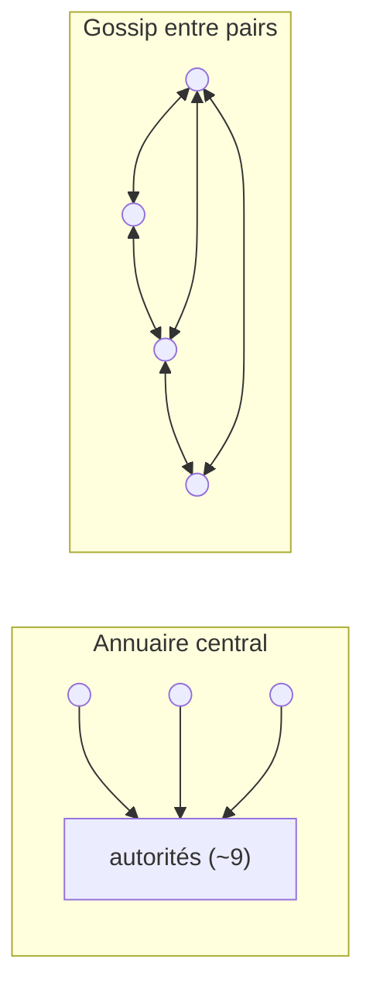
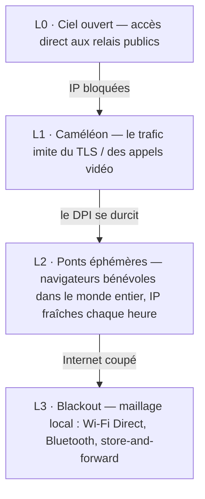

# ScrambNet — Architecture

> Brouillon de travail. Tout ce qui suit est ouvert à l'attaque : ouvrez une issue contre
> n'importe quelle affirmation. La maxime de conception est celle de Shannon :
> **« l'ennemi connaît le système. »** Si un détail doit rester secret pour que le réseau
> fonctionne, ce détail est un défaut.

ScrambNet superpose cinq mécanismes. Chacun suppose que les couches situées en dessous de lui sont hostiles ou absentes.

## L0 — Identité sans registre

Une identité est une paire de clés générée sur l'appareil. Il n'y a pas d'étape d'inscription, pas de numéro de
téléphone, pas d'adresse de courriel, pas de base de données de comptes où que ce soit. Conséquences :

- Il n'existe aucune liste d'utilisateurs, parce qu'il n'y a aucun moment où un utilisateur s'inscrit.
- Une identité que personne ne délivre est une identité que personne ne peut révoquer, assigner en justice ou vendre.
- Le matériel de clé ne quitte jamais l'appareil ; perdre l'appareil, c'est perdre l'identité
  (la récupération sociale par `k`-sur-`n` parts détenues par des amis choisis est un élément de
  conception ouvert — la même primitive de dispersion que le réseau utilise déjà).

## L1 — Découverte sans centre

Le véritable point unique des réseaux d'anonymat déployés aujourd'hui est la découverte. Les clients
Tor récupèrent un consensus de réseau produit par moins de dix autorités d'annuaire aux adresses
bien connues et codées en dur. Elles sont tenues honorablement — et elles restent une cible : bloquez-les
toutes et les nouveaux clients sont aveugles.

ScrambNet remplace le centre par trois mécanismes :

1. **Enregistrements de relais auto-signés.** Chaque relais publie un enregistrement (adresse, clés, transports,
   bande passante annoncée) signé par sa propre clé. Un nœud malveillant peut mentir sur lui-même ; il ne peut
   pas mentir sur les autres.
2. **Gossip à échantillonnage vérifiable.** Les clients ne détiennent pas la carte complète du réseau. Chaque
   client détient un échantillon qu'il peut vérifier, échangé avec ses pairs — suivant la ligne de
   recherche ouverte par *Walking Onions* (Komlo, Mathewson, Goldberg), qui existe précisément
   pour retirer ce poids de Tor.
3. **Distribution des ponts par le graphe social.** Là où le réseau ouvert est bloqué, les points d'entrée
   sont transmis de personne à personne le long du graphe social, avec des niveaux de confiance qui croissent
   dans le temps, comme dans le *Lox* de Tor. Un censeur peut se faire passer pour un utilisateur ; il ne peut
   pas se faire passer pour l'ami de tout le monde.

Problèmes ouverts : attaques par éclipse sur l'échantillonnage, résistance aux sybils sans allocateur
central, amorçage pour un utilisateur sans aucun contact. Voir [threat-model.md](threat-model.md#open-problems).

## L2 — Routage : la dispersion d'abord, les oignons ensuite

### Le mur porteur : la dispersion `k`-sur-`n`

Chaque message est découpé par le partage de secret de Shamir (1979) en `n` parts ; `k`
quelconques le reconstituent ; `k−1` quelconques sont statistiquement indiscernables d'un bruit aléatoire. C'est
informationnel-théorique, non calculatoire : un adversaire à `k−1` parts doté d'une puissance de calcul
illimitée ne détient rien, parce qu'il n'y a rien. Le régime importe et il est énoncé sans détour : cette
garantie inconditionnelle est le plancher *en deçà* de `k` parts. À `k` parts ou au-delà, un adversaire
réassemble le texte chiffré et affronte alors l'AEAD de bout en bout — une ceinture calculatoire, non un
second mur relevant de la théorie de l'information (spécification SP-1/SP-1a). Le pari du projet est que le
plancher au-dessous de cette ceinture ne peut pas expirer, non que la ceinture est incassable.

Les parts voyagent par des **chemins disjoints** : des nœuds de garde différents, des chemins choisis pour éviter de
partager des systèmes autonomes et des juridictions, et — quand le client juge que cela en vaut le coût —
des transports entièrement différents (une part par TLS, une par un flux à l'allure de WebRTC, une par
le maillage local).

Ce que cela achète, concrètement :

- **Confidentialité sans hypothèses.** Lire un message exige de tenir physiquement
  `k` positions du réseau au même instant. C'est un problème d'occupation, non un
  problème de cryptanalyse, et il ne s'affaiblit pas à mesure que les mathématiques progressent.
- **Tolérance aux pannes gratuite.** `k < n` signifie que `n − k` chemins peuvent échouer ou être bloqués sans
  perdre le message.
- **Un coût annoncé.** `n` parts coûtent `n×` la bande passante. Les valeurs par défaut (`n = 4, k = 3` pour
  la messagerie ; `n = 2, k = 2` plus FEC pour les flux de volume ?) sont une question de réglage ouverte.

### La seconde ceinture : des circuits en oignon légers

Chaque part voyage à l'intérieur de son propre circuit en oignon : 3 sauts, chiffrement par couches, de sorte
qu'aucun relais ne voit plus que son prédécesseur et son successeur. Les paquets utilisent le format **Sphinx** (Danezis &
Goldberg, 2009) : taille fixe à chaque saut, de sorte que la position dans le chemin n'est pas observable.
Les primitives sont délibérément ennuyeuses et rapides sur un téléphone bon marché : X25519, ChaCha20-Poly1305,
poignées de main du Noise Protocol Framework.

Si toute cette couche calculatoire s'effondre un jour, le réseau ne devient pas lisible —
l'adversaire est toujours à court de `k` positions simultanées. Il devient moins commode.

### Deux régimes

- **Rapide :** 3 sauts par part, pas de mixage. Latence de navigation. Vulnérable à la corrélation
  temporelle de bout en bout par un adversaire qui surveille `k` chemins aux deux extrémités.
- **Paranoïaque :** les mêmes paquets Sphinx entrent dans un mixnet avec des délais par saut et du trafic de
  couverture, pour la source qui parle à un journaliste et peut échanger des secondes contre une résistance
  à l'analyse temporelle.

## L3 — Transport : le caméléon

Les censeurs modernes ne lisent pas le contenu ; ils font correspondre des empreintes. Chaque protocole a une
poignée de main caractéristique, reconnaissable en quelques paquets par le DPI. La réponse est de n'avoir aucune
empreinte propre : des enveloppes interchangeables qui imitent du TLS ordinaire (empreinte de navigateur
via uTLS, noms de serveur masqués par ECH) ou un appel WebRTC ordinaire. Le but est économique :
bloquer l'enveloppe doit signifier bloquer le commerce qui circule sur les mêmes protocoles —
non pas « vous ne pouvez pas me bloquer » mais « me bloquer vous coûte plus que cela ne vous rapporte ».

## L4 — Blackout : le réseau se dégrade, il ne meurt pas

Le cas limite qui motive le projet : un régime coupe Internet dans une région.
Un réseau purement en surcouche y meurt. ScrambNet descend une échelle à la place :

En mode blackout, les messages sautent d'appareil en appareil par Wi-Fi Direct et Bluetooth et patientent
en file jusqu'à ce qu'un appareil retrouve une route vers l'extérieur (store-and-forward), comme Briar et Reticulum
le démontrent déjà sur du matériel réel. Un message peut traverser une ville à la vitesse d'un bus — ce qui est
infiniment mieux que zéro. La dispersion s'applique toujours : les parts peuvent emprunter différents
supports physiques.

## Qui exécute quoi — rôles de participation

La livraison ne vise jamais une personne : les destinataires détiennent des cartes de contact par relation
et collectent les parts depuis des dead-drops dispersés, derrière leurs propres circuits
(spécification Partie 6). Autour de cela se déploie un éventail de rôles, tous choisis,
aucun imposé :

- **Client pur** — quasi invisible, pour les personnes dans les endroits où participer est
  déjà dangereux en soi ; il circule sur les ponts et les transports caméléon.
- **Relais + utilisateur** — l'ossature naturelle là où le risque est faible : le trafic de transit
  est une couverture gratuite pour son propre trafic, la capacité croît avec l'usage. Le prix est une
  adresse publiée ; la discipline est un horaire toujours actif, car un relais
  qui est en ligne exactement quand son opérateur discute est une attaque par intersection contre
  lui-même.
- **Relais pur / drop** — le bénévole dans une juridiction sûre qui transporte et
  stocke pour ceux qui ne le sont pas. Le trafic de messagerie n'a pas de sortie en clair-web : un
  relais retransmet du bruit de taille fixe et un drop stocke des parts qu'il ne peut ni lire ni
  relier, ce qui maintient l'exposition du bénévole structurellement plus basse que celle d'une sortie
  Tor.
- **Nœud de maillage / passerelle** — toujours un choix explicite, car sa visibilité
  est physique, à l'échelle du quartier.

Nul n'a besoin d'être visible pour participer ; nul ne paie pour ceux qui ne peuvent pas s'offrir
la visibilité. La valeur par défaut suggérée pour ceux qui sont à l'abri est de contribuer.

## L'art antérieur que cette conception compose

| Pièce | Année | Rôle ici |
|---|---|---|
| Partage de secret de Shamir | 1979 | Le mur porteur : dispersion inconditionnelle |
| Dispersion d'information de Rabin | 1989 | Dispersion économe en espace pour les données de volume |
| DC-nets de Chaum | 1988 | Point de référence pour l'anonymat inconditionnel en petits groupes |
| Format de paquet Sphinx | 2009 | Paquets de taille fixe, masquant la position |
| Noise Protocol Framework | 2016 | Poignées de main (comme dans WireGuard) |
| uTLS / ECH | — | Camouflage d'empreinte |
| Snowflake, Lox (Tor) | — | Ponts éphémères ; distribution par le graphe social |
| Walking Onions | 2020 | Découverte par échantillon vérifiable |
| Briar, Reticulum | — | Preuve que la couche blackout fonctionne sur du matériel réel |
| Pond, Loopix | 2015–2017 | Dead-drops et boîtes aux lettres chez un fournisseur — le schéma de livraison que la Partie 6 disperse |

La contribution n'est pas une nouvelle primitive. C'est une composition dans laquelle la primitive qui
ne peut pas expirer porte la charge, et tout ce qui peut expirer est une commodité.
