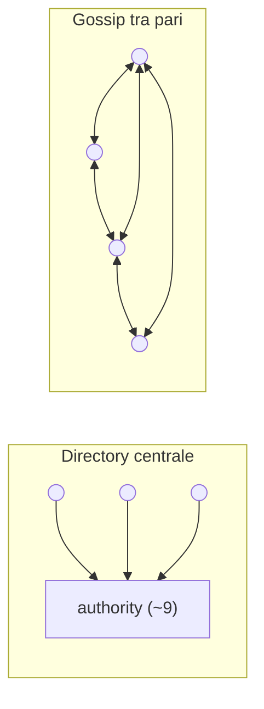
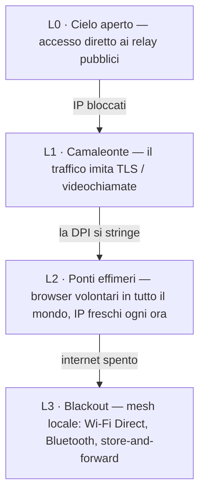

# ScrambNet — Architettura

> Bozza di lavoro. Tutto ciò che segue è aperto all'attacco: apri una issue contro qualsiasi affermazione.
> La massima di progetto è quella di Shannon: **«il nemico conosce il sistema».** Se un dettaglio deve restare
> segreto perché la rete funzioni, quel dettaglio è un difetto.

ScrambNet stratifica cinque meccanismi. Ciascuno assume che i livelli sottostanti siano ostili o assenti.

## L0 — Identità senza registro

Un'identità è una coppia di chiavi generata sul dispositivo. Non c'è alcun passo di registrazione, nessun numero
di telefono, nessun indirizzo e-mail, nessun database di account da nessuna parte. Conseguenze:

- Non esiste un elenco di utenti, perché non esiste un momento in cui un utente si registra.
- Un'identità che nessuno rilascia è un'identità che nessuno può revocare, sottoporre a mandato o vendere.
- Il materiale crittografico non lascia mai il dispositivo; perdere il dispositivo significa perdere l'identità
  (il recupero sociale tramite quote `k`-su-`n` affidate ad amici scelti è un elemento di progetto aperto —
  la stessa primitiva di dispersione che la rete già usa).

## L1 — Scoperta senza centro

Il vero punto unico nelle reti anonime oggi in esercizio è la scoperta. I client Tor
scaricano un consenso di rete prodotto da meno di dieci directory authority con indirizzi noti e
cablati nel codice. Sono gestite onorevolmente — e restano un bersaglio: bloccale tutte e i
nuovi client sono ciechi.

ScrambNet sostituisce il centro con tre meccanismi:

1. **Record di relay autofirmati.** Ogni relay pubblica un record (indirizzo, chiavi, trasporti,
   dichiarazione di banda) firmato dalla propria chiave. Un nodo malevolo può mentire su sé stesso; non può
   mentire sugli altri.
2. **Gossip con campionamento verificabile.** I client non possiedono la mappa completa della rete. Ogni
   client possiede un campione che può verificare, scambiato con i pari — seguendo la linea di
   ricerca aperta da *Walking Onions* (Komlo, Mathewson, Goldberg), che esiste proprio per
   togliere questo peso a Tor.
3. **Distribuzione dei ponti lungo il grafo sociale.** Dove la rete aperta è bloccata, i punti d'ingresso
   vengono passati di persona in persona lungo il grafo sociale, con livelli di fiducia che crescono nel
   tempo, come in *Lox* di Tor. Un censore può fingersi un utente; non può fingersi l'amico di tutti.

Problemi aperti: attacchi di eclipse sul campionamento, resistenza ai sybil senza un allocatore centrale,
bootstrap per un utente senza contatti. Vedi [threat-model.md](threat-model.md#open-problems).

## L2 — Instradamento: prima la dispersione, poi le cipolle

### Il muro portante: dispersione `k`-su-`n`

Ogni messaggio è scomposto con lo schema di Shamir (1979) in `n` quote; `k` qualsiasi
lo ricostruiscono; `k−1` qualsiasi sono statisticamente indistinguibili dal rumore casuale. Questo è
teorico-informativo, non computazionale: un avversario con `k−1` quote e potenza di calcolo
illimitata non possiede nulla, perché nulla è lì. Il regime conta ed è dichiarato con
chiarezza: questa garanzia incondizionata è il livello minimo *al di sotto* delle `k` quote. A partire
dalle `k` quote un avversario ricompone il testo cifrato e si trova poi davanti all'AEAD end-to-end —
una cintura computazionale, non un secondo muro teorico-informativo (spec SP-1/SP-1a). La scommessa
del progetto è che il livello minimo sotto quella cintura non possa scadere, non che la cintura sia
inviolabile.

Le quote viaggiano su **percorsi disgiunti**: nodi di guardia diversi, percorsi scelti per evitare di condividere
sistemi autonomi e giurisdizioni e — quando il client ritiene che ne valga il costo —
trasporti del tutto diversi (una quota su TLS, una su un flusso dalla forma di WebRTC, una sulla
mesh locale).

Cosa si guadagna, concretamente:

- **Riservatezza senza assunzioni.** Leggere un messaggio richiede di tenere fisicamente
  `k` posizioni della rete nello stesso istante. È un problema di occupazione, non di
  crittoanalisi, e non si indebolisce con l'avanzare della matematica.
- **Tolleranza ai guasti gratuita.** `k < n` significa che `n − k` percorsi possono guastarsi o essere bloccati senza
  perdere il messaggio.
- **Un costo dichiarato.** `n` quote costano `n×` di banda. I valori di default (`n = 4, k = 3` per
  la messaggistica; `n = 2, k = 2` più FEC per i flussi di massa?) sono una questione di messa a punto aperta.

### La seconda cintura: circuiti a cipolla leggeri

Ogni quota viaggia dentro il proprio circuito a cipolla: 3 salti, cifratura a strati, così che nessun relay
veda più del suo predecessore e del suo successore. I pacchetti usano il formato **Sphinx** (Danezis &
Goldberg, 2009): dimensione fissa a ogni salto, così che la posizione nel percorso non sia osservabile.
Le primitive sono deliberatamente noiose e veloci su un telefono economico: X25519, ChaCha20-Poly1305,
handshake dal Noise Protocol Framework.

Se un giorno tutto questo livello computazionale cadesse, la rete non diventa leggibile —
l'avversario è ancora a corto di `k` posizioni simultanee. Diventa meno comoda.

### Due marce

- **Veloce:** 3 salti per quota, nessun mixing. Latenza da navigazione. Vulnerabile alla
  correlazione temporale end-to-end da parte di un avversario che osserva `k` percorsi a entrambe le estremità.
- **Paranoica:** gli stessi pacchetti Sphinx entrano in una mixnet con ritardi per salto e traffico di
  copertura, per la sorgente che parla con un giornalista e può barattare secondi in cambio di resistenza
  all'analisi temporale.

## L3 — Trasporto: il camaleonte

I censori moderni non leggono il contenuto; confrontano impronte. Ogni protocollo ha un
handshake caratteristico, riconoscibile in pochi pacchetti di DPI. La risposta è non avere alcuna
impronta propria: involucri modulari che imitano un normale TLS (impronta del browser
via uTLS, nomi di server nascosti da ECH) o una normale chiamata WebRTC. L'obiettivo è economico:
bloccare l'involucro deve significare bloccare il commercio che gira sugli stessi protocolli —
non «non puoi bloccarmi» ma «bloccarmi costa più di quanto ti renda».

## L4 — Blackout: la rete degrada, non muore

Il caso limite che motiva il progetto: un regime spegne internet in una regione.
Una rete solo overlay lì muore. ScrambNet scende invece una scala:

In modalità blackout, i messaggi saltano da dispositivo a dispositivo su Wi-Fi Direct e Bluetooth e si accodano
finché un qualsiasi dispositivo non riacquista una via d'uscita (store-and-forward), come Briar e Reticulum già
dimostrano su hardware reale. Un messaggio può attraversare una città alla velocità di un autobus — il che è
infinitamente meglio di zero. La dispersione si applica ancora: le quote possono prendere vettori fisici diversi.

## Chi gestisce cosa — ruoli di partecipazione

La consegna non prende mai di mira una persona: i destinatari possiedono carte di contatto per relazione
e raccolgono quote da dead drop dispersi, da dietro i propri circuiti
(spec Parte 6). Attorno a questo si dispone uno spettro di ruoli, ognuno dei quali scelto,
nessuno obbligatorio:

- **Client puro** — quasi invisibile, per chi si trova in luoghi dove partecipare è
  di per sé pericoloso; cavalca ponti e trasporti camaleonte.
- **Relay + utente** — la spina dorsale naturale dove il rischio è basso: il traffico di transito
  è copertura gratuita per il proprio traffico, la capacità cresce con l'uso. Il prezzo è un
  indirizzo pubblicato; la disciplina è un orario sempre attivo, perché un relay
  che è acceso esattamente quando il suo operatore chatta è un attacco a intersezione su
  sé stesso.
- **Relay puro / drop** — il volontario in una giurisdizione sicura che trasporta e
  conserva per chi non lo è. Il traffico di messaggistica non ha un'uscita verso il web in chiaro: un
  relay inoltra rumore a dimensione fissa e un drop conserva quote che non può leggere né
  collegare, il che mantiene l'esposizione del volontario strutturalmente più bassa di quella di un'uscita
  Tor.
- **Nodo mesh / gateway** — sempre un opt-in esplicito, perché la sua visibilità
  è fisica, su scala di quartiere.

Nessuno deve essere visibile per partecipare; nessuno paga per chi non può permettersi
la visibilità. Il default suggerito per chi è al sicuro è contribuire.

## Arte precedente che questo progetto compone

| Pezzo | Anno | Ruolo qui |
|---|---|---|
| Schema di Shamir | 1979 | Il muro portante: dispersione incondizionata |
| Information Dispersal di Rabin | 1989 | Dispersione efficiente nello spazio per dati di massa |
| DC-net di Chaum | 1988 | Punto di riferimento per l'anonimato incondizionato in piccoli gruppi |
| Formato pacchetto Sphinx | 2009 | Pacchetti a dimensione fissa, che nascondono la posizione |
| Noise Protocol Framework | 2016 | Handshake (come in WireGuard) |
| uTLS / ECH | — | Mimetizzazione delle impronte |
| Snowflake, Lox (Tor) | — | Ponti effimeri; distribuzione lungo il grafo sociale |
| Walking Onions | 2020 | Scoperta per campione verificabile |
| Briar, Reticulum | — | Prova che il livello blackout funziona su hardware reale |
| Pond, Loopix | 2015–2017 | Dead drop e caselle del provider — il pattern di consegna che la Parte 6 disperde |

Il contributo non è una nuova primitiva. È una composizione in cui la primitiva che
non può scadere porta il carico, e tutto ciò che può scadere è una comodità.
