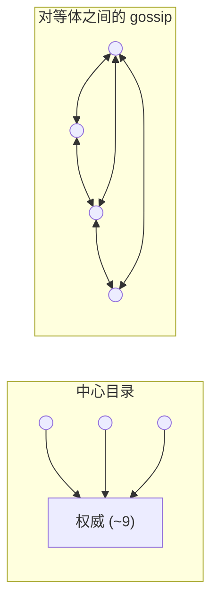
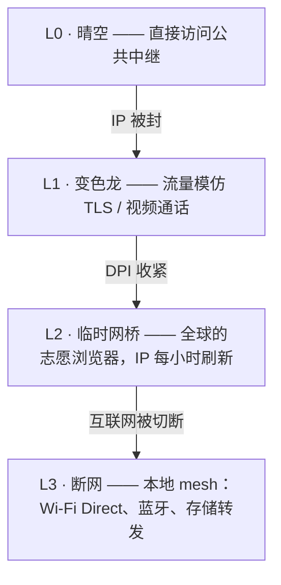

# ScrambNet —— 架构

> 工作草稿。这里的一切都欢迎攻击：对任何论断都可以提一个 issue。
> 设计箴言源自 Shannon：**「敌人知道整个系统」。** 如果任何细节必须保密网络才能运作，
> 那个细节就是缺陷。

ScrambNet 叠加了五重机制。每一重都假定其下方的各层是敌意的或根本不存在。

## L0 —— 无需注册表的身份

一个身份就是在设备上生成的一对密钥。没有任何注册步骤，没有电话号码，没有电子邮件地址，
任何地方都没有账户数据库。由此产生的后果：

- 不存在用户名单，因为不存在用户注册的那个时刻。
- 无人颁发的身份，也就无人能够吊销、传唤或出售。
- 密钥材料永不离开设备；丢失设备就意味着丢失身份
  （通过交由选定好友保管的 `k`-之-`n` 份额实现的社交恢复，是一项开放的设计议题——
  也就是网络已经在用的同一套分散原语）。

## L1 —— 无需中心的发现

当今已部署的匿名网络中真正的单点，是发现。Tor 客户端
下载一份由不足十个目录权威产出的网络共识，这些权威拥有众所周知、
硬编码的地址。它们被光明正大地运营着——但依然是靶子：把它们全部封锁，
新客户端就成了瞎子。

ScrambNet 用三种机制取代中心：

1. **自签名的中继记录。** 每个中继发布一份记录（地址、密钥、传输方式、
   带宽声称），由它自己的密钥签名。一个恶意节点可以就自身撒谎；却无法
   就他者撒谎。
2. **带可验证抽样的 gossip。** 客户端并不持有完整的网络地图。每个
   客户端持有一份它能验证的抽样，与对等体交换——沿着
   *Walking Onions*（Komlo、Mathewson、Goldberg）开辟的研究路线，而该研究存在的意义，
   正是为了把这份重量从 Tor 身上卸下。
3. **沿社交图谱的网桥分发。** 在开放网络被封锁之处，入口点
   沿社交图谱一人传一人地交递，信任等级随时间
   增长，正如 Tor 的 *Lox*。审查者可以冒充一个用户；却无法冒充所有人的朋友。

开放问题：针对抽样的 eclipse 攻击、无需中心分配器的抗女巫、
零联系人用户的 bootstrap。参见 [threat-model.md](threat-model.md#open-problems)。

## L2 —— 路由：先分散，后洋葱

### 承重墙：`k`-之-`n` 分散

每条消息都用 Shamir 秘密共享（1979）拆分为 `n` 份额；任意 `k` 份
即可重建；任意 `k−1` 份在统计上与随机噪声不可区分。这是
信息论意义上的，而非计算意义上的：一个持有 `k−1` 份额、拥有无限算力的
对手什么也没掌握，因为那里本就空无一物。

这一区制要紧，而且明说在此：这项无条件保证是 `k` 份份额*以下*的那条下界。
在 `k` 份份额或其之上，对手会重组出密文，继而面对端到端的 AEAD——一道计算型
护带，而非第二道信息论之墙（规范 SP-1/SP-1a）。本项目的赌注在于，那道护带底下
的下界无法过期，而非那道护带牢不可破。

份额在**互不相交的路径**上传输：不同的守卫节点、为避免共享
自治系统与司法辖区而选取的路径，以及——当客户端判定值得付出代价时——
完全不同的传输方式（一份走 TLS，一份走形似 WebRTC 的流量，一份走本地
mesh）。

具体换来的是：

- **无需假设的机密性。** 读取一条消息，要求在同一瞬间物理地占据
  网络中的 `k` 个位置。那是一个占领问题，而非
  密码分析问题，它不会随着数学的进展而削弱。
- **免费附赠的容错。** `k < n` 意味着 `n − k` 条路径可以失效或被封锁，而不致
  丢失消息。
- **一个明示的代价。** `n` 份额要花费 `n×` 的带宽。各默认值（消息场景用 `n = 4, k = 3`；
  批量流量用 `n = 2, k = 2` 外加 FEC？）是一个开放的调参问题。

### 第二道防线：轻量洋葱链路

每一份额都在它自己的洋葱链路中传输：3 跳、分层加密，使得任何中继
看到的都不超过它的前驱和后继。数据包采用 **Sphinx** 格式（Danezis &
Goldberg，2009）：在每一跳都保持定长，使得在路径中的位置不可观测。
各原语刻意选得乏味而在廉价手机上运行迅速：X25519、ChaCha20-Poly1305、
出自 Noise Protocol Framework 的握手。

假使有朝一日整个计算层都倒下，网络也不会变得可读——
对手依然凑不齐 `k` 个同时占据的位置。它只是变得不那么方便。

### 两档

- **快速档：** 每份额 3 跳，不做混合。浏览级延迟。易受
  在两端观察 `k` 条路径的对手施以的端到端时序关联。
- **偏执档：** 同样的 Sphinx 数据包进入一个带逐跳延迟和掩护流量的
  混合网络，供面对记者、能以秒数换取抗时序分析能力的
  信源使用。

## L3 —— 传输：变色龙

现代审查者并不读取内容；他们比对指纹。每一种协议都有一个
特征性的握手，在几个 DPI 数据包内即可识别。应对之道是让自己毫无
指纹可言：模仿普通 TLS（通过 uTLS 伪装浏览器指纹，
通过 ECH 隐藏服务器名）或普通 WebRTC 通话的可插拔外壳。目标是经济上的：
封锁这层外壳必须意味着封锁跑在同一批协议之上的商业活动——
不是「你封不了我」，而是「封我的代价高于你的所得」。

## L4 —— 断网：网络降级，而非死亡

驱动本项目的极端情形：某政权在某地区关停互联网。
纯叠加网络在那里会死亡。ScrambNet 则沿着一道阶梯向下：

在断网模式下，消息经由 Wi-Fi Direct 与蓝牙在设备间逐跳传递，并排队
等待任一设备重新获得一条出口路径（存储转发），正如 Briar 与 Reticulum 已在
真实硬件上所证明。一条消息可以以一辆公交车的速度穿越一座城市——而这
比归零要好上无穷倍。分散依然适用：各份额可以搭乘不同的物理载体。

## 谁运行什么 —— 参与角色

投递从不针对某个人：接收者持有按关系区分的联系卡，
并从分散的死信箱、从自己的链路之后收集份额
（规范第 6 部分）。围绕这一点，是一道角色谱系，其中每一个都出于选择，
无一是强制的：

- **纯客户端** —— 近乎隐形，面向身处那些仅仅参与本身
  就危险的地方的人；搭乘网桥与变色龙传输。
- **中继 + 用户** —— 在风险低之处的天然骨干：过境流量
  是为自身流量提供的免费掩护，容量随使用而增长。代价是一个
  公布的地址；纪律则是一个始终在线的作息，因为一个
  恰好在运营者聊天时才上线的中继，就是对
  自身发起的交集攻击。
- **纯中继 / 死信箱** —— 身处安全辖区、为那些不在安全辖区者
  承载与存储的志愿者。消息流量没有明网出口：
  中继转发定长噪声，死信箱存储它既读不了也无法
  关联的份额，这使志愿者的暴露面在结构上低于一个 Tor
  出口。
- **Mesh 节点 / 网关** —— 永远是显式的自愿加入，因为它的可见性
  是物理的，在街区尺度上。

无人为参与必须现身；无人为那些负担不起现身的人
买单。对身处安全者，建议的默认选择是贡献。

## 本设计所组合的既有成果

| 组件 | 年份 | 在此处的作用 |
|---|---|---|
| Shamir 秘密共享 | 1979 | 承重墙：无条件分散 |
| Rabin 信息分散 | 1989 | 面向批量数据的空间高效分散 |
| Chaum DC 网络 | 1988 | 小群体内无条件匿名的参照点 |
| Sphinx 数据包格式 | 2009 | 定长、隐藏位置的数据包 |
| Noise Protocol Framework | 2016 | 握手（如 WireGuard 中所用） |
| uTLS / ECH | — | 指纹伪装 |
| Snowflake、Lox（Tor） | — | 临时网桥；沿社交图谱的分发 |
| Walking Onions | 2020 | 以可验证抽样进行发现 |
| Briar、Reticulum | — | 证明断网层在真实硬件上可行 |
| Pond、Loopix | 2015–2017 | 死信箱与提供商信箱 —— 第 6 部分所分散的投递模式 |

本设计的贡献不是一项新原语。它是一种组合：在这组合中，由那条无法过期的
原语承载重量，而一切可能过期之物都只是便利。
